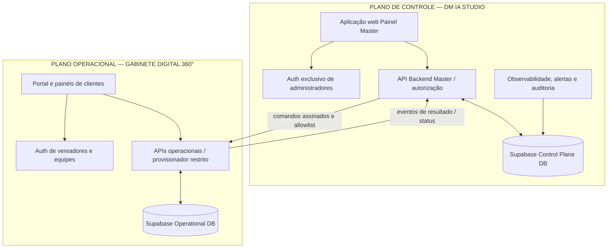
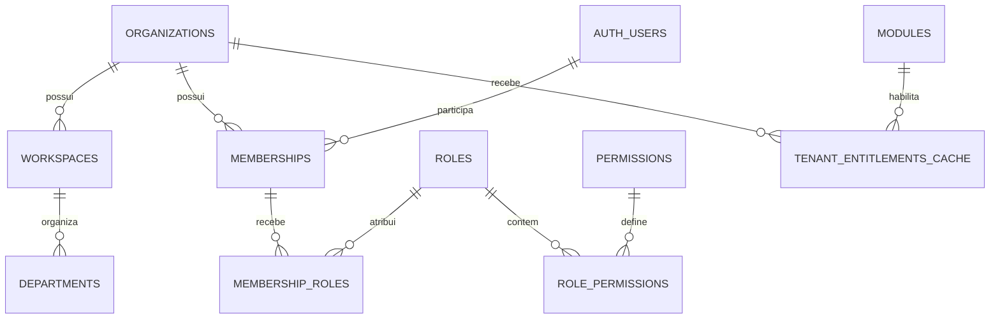
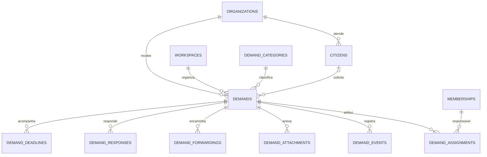
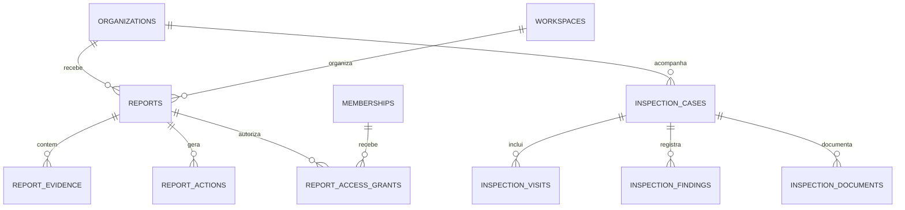
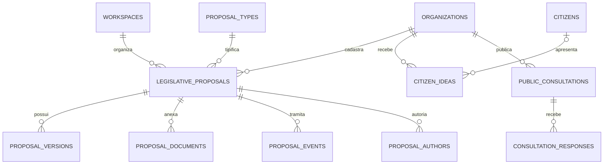
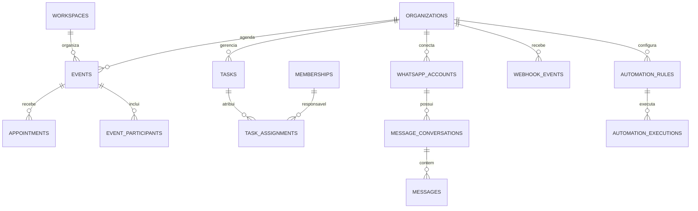
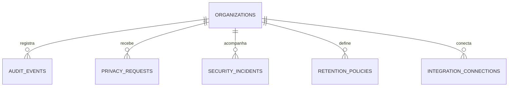

# Gabinete Digital 360° — DER, Dicionário de Dados e Segurança

Versão: 2.0 — Modelo lógico atualizado com Plano de Controle (Painel Master)

**Status:** especificação de arquitetura e dados para revisão; não é SQL executável nem foi aplicado a um projeto Supabase.

## 1. Premissas e decisões

- SaaS multi-tenant para vereadores e Câmaras Municipais.
- A arquitetura tem dois planos: **Plano de Controle (Control Plane)**, que administra o produto, e **Plano Operacional (Application/Data Plane)**, que atende gabinetes e Câmaras.
- O Painel Master é uma aplicação web separada, com domínio, deployment, autenticação e projeto Supabase próprios. Não é apenas uma rota administrativa dentro do painel dos clientes.
- O Plano Operacional começa como aplicação multi-tenant em projeto Supabase próprio, compartilhado pelos clientes e protegido por RLS, permissões e chaves compostas. Projetos operacionais dedicados a clientes maiores podem ser avaliados em etapa futura.
- `platform_tenant` no Plano de Controle representa o cliente comercial/contratante; `organization` no Plano Operacional representa seu contexto de dados. O vínculo entre os dois é um identificador externo controlado pelo backend, pois não existe FK relacional entre projetos Supabase distintos.
- `organization` representa o cliente operacional (gabinete individual ou Câmara); `workspace` representa um ambiente operacional dentro da organização; `department` representa gabinete, setor ou unidade.
- Todos os registros operacionais têm `organization_id`; registros vinculados a um ambiente também têm `workspace_id`.
- Identidades de administradores da plataforma são distintas das identidades de vereadores, servidores e equipes dos clientes. Não existe `is_master` em `profiles`, `memberships` ou `user_metadata` do Plano Operacional.
- O Painel Master administra ciclo de vida do cliente, contratos, módulos, limites, provisionamento, usuários iniciais, incidentes, saúde e auditoria da plataforma. Não recebe acesso irrestrito ao conteúdo operacional dos clientes.
- Administradores do cliente gerenciam a equipe, papéis e acessos internos do próprio gabinete/Câmara. O Master pode iniciar ações administrativas excepcionais, sempre com escopo, motivo, aprovação quando aplicável, prazo e auditoria.
- A autorização é feita no servidor e no PostgreSQL. Nunca confiar em `tenant_id`, papel ou permissões enviados pelo navegador.
- Denúncias/comunicações restritas ficam em domínio separado do CRM comum e não são acessíveis por padrão nem mesmo ao suporte da plataforma.
- Credenciais privilegiadas ficam apenas em serviços backend; nunca em navegador, aplicativo mobile, código público ou variáveis `NEXT_PUBLIC_`.
- O esquema abaixo é uma especificação lógica. Deve ser revisado, migrado e testado em projeto Supabase de desenvolvimento antes da produção.

### 1.1 Decisão arquitetural: Painel Master isolado

O desenho recomendado é:



**Isolamento físico/lógico proposto:** projeto Supabase `control-plane` para painel master e projeto Supabase `operational-plane` para a aplicação dos clientes; dois deployments web separados; duas instâncias de Auth separadas. Uma chamada do Master ao Plano Operacional ocorre exclusivamente por API backend restrita de provisionamento, nunca por acesso genérico ao banco operacional.

**Não fazer:** conectar o navegador do Master diretamente ao banco de clientes; compartilhar cookies de autenticação entre os subdomínios; dar ao Master uma chave secreta operacional para consultas livres; ou criar um papel `super_admin` dentro dos tenants.

### 1.2 Fonte de verdade e projeções sincronizadas

| Informação | Fonte de verdade | Cópia/projeção no Plano Operacional |
|---|---|---|
| Contrato, plano, assinatura e cobrança | Plano de Controle | Não armazenar dados financeiros; apenas estado mínimo de habilitação, se necessário |
| Catálogo de módulos e módulos contratados | Plano de Controle | Snapshot de entitlement versionado, somente leitura pelo app |
| Cliente comercial, status comercial e provisionamento | Plano de Controle | `organizations` guarda o contexto operacional e `platform_tenant_id` externo |
| Domínios e roteamento de clientes | Plano de Controle | Cache/lookup mínimo para resolver tenant pelo host validado |
| Papéis de funcionários da DM IA Studio | Plano de Controle | Nunca replicar como papel de usuário do tenant |
| Papéis e permissões do gabinete/Câmara | Plano Operacional | Não replicar ao Control Plane, exceto indicadores agregados não sensíveis |
| Demandas, cidadãos, denúncias, propostas e mensagens | Plano Operacional | Não replicar ao Control Plane; expor somente métricas agregadas necessárias |
| Auditoria administrativa da plataforma | Plano de Controle | Não aplicável |
| Auditoria de ações dos usuários do cliente | Plano Operacional | Não copiar conteúdo; exportação de eventos agregados só com finalidade definida |

O snapshot de módulos no Plano Operacional é uma projeção técnica para disponibilidade e desempenho. Ele não substitui a fonte de verdade comercial e não concede permissões sobre linhas de dados. A autorização de dados continua baseada em membership, escopo, permissões e RLS.

## 2. DER lógico — entidades e relacionamentos

### 2.1 Plano de Controle — Painel Master

```mermaid
erDiagram
  PLATFORM_ADMINS ||--o{ PLATFORM_ADMIN_ROLE_ASSIGNMENTS : recebe
  PLATFORM_ROLES ||--o{ PLATFORM_ADMIN_ROLE_ASSIGNMENTS : atribui
  PLATFORM_ROLES ||--o{ PLATFORM_ROLE_PERMISSIONS : contem
  PLATFORM_PERMISSIONS ||--o{ PLATFORM_ROLE_PERMISSIONS : define
  PLATFORM_TENANTS ||--o{ TENANT_SUBSCRIPTIONS : contrata
  PLATFORM_PLANS ||--o{ TENANT_SUBSCRIPTIONS : classifica
  PLATFORM_TENANTS ||--o{ TENANT_MODULE_ENTITLEMENTS : habilita
  PLATFORM_MODULES ||--o{ TENANT_MODULE_ENTITLEMENTS : concede
  PLATFORM_TENANTS ||--o{ TENANT_DOMAINS : publica
  PLATFORM_TENANTS ||--o{ TENANT_PROVISIONING_JOBS : provisiona
  TENANT_PROVISIONING_JOBS ||--o{ TENANT_PROVISIONING_STEPS : executa
  PLATFORM_TENANTS ||--o{ PLATFORM_AUDIT_EVENTS : audita
  PLATFORM_ADMINS ||--o{ PLATFORM_AUDIT_EVENTS : pratica
  PLATFORM_TENANTS ||--o{ SUPPORT_ACCESS_REQUESTS : solicita
  SUPPORT_ACCESS_REQUESTS ||--o| SUPPORT_ACCESS_GRANTS : aprova
  PLATFORM_TENANTS ||--o{ TENANT_USAGE_DAILY : mede
  PLATFORM_INCIDENTS ||--o{ INCIDENT_EVENTS : registra
  PLATFORM_SERVICES ||--o{ SERVICE_HEALTH_SNAPSHOTS : monitora
```



O Control Plane não replica tabelas de atendimento, denúncias, mensagens ou documentos dos clientes. O seu DER descreve governança do produto, provisionamento, autorização dos administradores da plataforma, operação e monitoramento.

### 2.2 Plano Operacional — organização e acesso dos clientes


### 2.3 CRM, cidadãos e atendimento


### 2.4 Denúncias e fiscalização — domínio restrito


### 2.5 Legislativo, participação e consultas


### 2.6 Agenda, tarefas e comunicação


### 2.7 Auditoria, privacidade e operação


## 3. Dicionário de dados

Convenções:
- PK: chave primária UUID.
- FK: chave estrangeira.
- `created_at`, `updated_at`: `timestamptz`.
- `organization_id`: escopo obrigatório do cliente em tabelas multi-tenant.
- `workspace_id`: escopo operacional, quando aplicável.
- Campos de conteúdo livre devem ter limites de tamanho e validação.
- `metadata jsonb` somente para atributos auxiliares não críticos; não substituir colunas relacionais nem autorização.

### 3.1 Núcleo SaaS do Plano Operacional

**Atenção à divisão do v2:** as tabelas listadas abaixo que cuidam de usuário, membership, role e escopo operacional permanecem no banco dos clientes. `subscriptions`, catálogo comercial de módulos e domínios passam a ter fonte de verdade no Control Plane. Quando necessário, o Plano Operacional mantém apenas projeções técnicas minimizadas e sem autoridade comercial.


| Tabela | Campos principais | Regras |
|---|---|---|
| `organizations` | `id`, `platform_tenant_id`, `name`, `slug`, `kind` (`individual`,`chamber`), `status`, `legal_name`, `created_at` | `slug` e `platform_tenant_id` únicos; identificador externo imutável por membros comuns |
| `workspaces` | `id`, `organization_id`, `name`, `kind`, `status` | FK composta para organização |
| `departments` | `id`, `organization_id`, `workspace_id`, `name`, `kind`, `status` | pertence ao workspace |
| `profiles` | `user_id` (FK `auth.users`), `display_name`, `avatar_path`, `locale` | não usar perfil para conceder privilégios |
| `memberships` | `id`, `organization_id`, `user_id`, `status`, `joined_at` | único por organização/usuário |
| `roles` | `id`, `organization_id` nullable, `key`, `name`, `is_system` | papéis do Plano Operacional (gabinete/Câmara); nunca representam administradores da DM IA Studio |
| `permissions` | `id`, `key`, `description` | catálogo de permissões do Plano Operacional; distinto de `platform_permissions` |
| `role_permissions` | `role_id`, `permission_id` | PK composta |
| `membership_roles` | `membership_id`, `role_id`, `workspace_id` nullable | escopo da atribuição |
| `modules` | `id`, `key`, `name` | se mantida no Plano Operacional, é projeção/cache do catálogo controlado no Control Plane; sem edição pelo cliente |
| `organization_modules` | `organization_id`, `module_id`, `status`, `enabled_at`, `expires_at`, `limits jsonb`, `entitlement_version` | projeção sincronizada e não editável pelo cliente; valida disponibilidade do módulo, não autorização de dados |
| `domains` | `id`, `organization_id`, `hostname`, `verified_at`, `is_primary` | preferencialmente resolvido no Control Plane; se existir como cache local, deve ser projeção sincronizada e não fonte de verdade |
| `subscriptions` | `id`, `organization_id`, `plan_key`, `status`, `starts_at`, `ends_at`, `billing_reference` | legado lógico: mover para `tenant_subscriptions` no Control Plane; no Plano Operacional manter somente um estado mínimo de habilitação, se indispensável, sem dados de cobrança |
| `organization_settings` | `organization_id`, `settings jsonb` | allowlist de chaves; sem segredos |

### 3.2 CRM e atendimento

| Tabela | Campos principais | Regras |
|---|---|---|
| `citizens` | `id`, `organization_id`, `display_name`, `email`, `phone`, `preferred_channel`, `created_at` | minimizar dados; deduplicação cautelosa |
| `demand_categories` | `id`, `organization_id` nullable, `key`, `label`, `active` | catálogo global + customizado |
| `demands` | `id`, `organization_id`, `workspace_id`, `protocol`, `citizen_id` nullable, `category_id`, `subject`, `description`, `status`, `priority`, `source`, `location_text`, `assigned_department_id`, `created_by` nullable | protocolo único por organização; status por enum/check |
| `demand_assignments` | `id`, `organization_id`, `demand_id`, `membership_id`, `assigned_at`, `ended_at` | FK composta garante mesmo tenant |
| `demand_events` | `id`, `organization_id`, `demand_id`, `event_type`, `from_status`, `to_status`, `note`, `actor_membership_id` | trilha append-only |
| `demand_attachments` | `id`, `organization_id`, `demand_id`, `storage_path`, `mime_type`, `size_bytes`, `classification` | bucket privado; validar tipo e tamanho |
| `demand_forwardings` | `id`, `organization_id`, `demand_id`, `recipient_type`, `recipient_name`, `sent_at`, `reference_number`, `status` | registrar encaminhamento, não afirmar execução |
| `demand_responses` | `id`, `organization_id`, `demand_id`, `channel`, `body`, `sent_at`, `delivery_status` | guardar conteúdo mínimo necessário |
| `demand_deadlines` | `id`, `organization_id`, `demand_id`, `due_at`, `reason`, `completed_at` | prazo interno, não prazo legal presumido |

### 3.3 Denúncias e fiscalização

| Tabela | Campos principais | Regras |
|---|---|---|
| `reports` | `id`, `organization_id`, `workspace_id`, `public_reference`, `category`, `description`, `location_text`, `intake_mode`, `status`, `received_at`, `identity_vault_ref` nullable | sem FK para `citizens` em modo anônimo |
| `report_evidence` | `id`, `organization_id`, `report_id`, `storage_path`, `mime_type`, `size_bytes`, `sha256`, `classification` | bucket separado, privado |
| `report_access_grants` | `id`, `organization_id`, `report_id`, `membership_id`, `granted_by`, `expires_at`, `reason` | concessão individual, temporária e auditada |
| `report_actions` | `id`, `organization_id`, `report_id`, `action_type`, `description`, `destination`, `reference_number`, `actor_membership_id`, `created_at` | histórico append-only |
| `inspection_cases` | `id`, `organization_id`, `workspace_id`, `case_number`, `title`, `scope`, `status`, `opened_at`, `closed_at` | caso de fiscalização parlamentar |
| `inspection_visits` | `id`, `organization_id`, `inspection_case_id`, `visited_at`, `location_text`, `notes` | dados proporcionais à finalidade |
| `inspection_findings` | `id`, `organization_id`, `inspection_case_id`, `description`, `classification`, `source_reference` | não declarar culpa; registrar constatação |
| `inspection_documents` | `id`, `organization_id`, `inspection_case_id`, `storage_path`, `classification` | bucket privado |

**Importante sobre anonimato:** não coletar identidade, telefone, e-mail ou identificador de conta no fluxo anônimo. Não vincular a ocorrência a `citizens`. Configurar minimização de logs nos componentes sob controle do operador, sem prometer anonimato absoluto perante toda a infraestrutura. A plataforma não deve oferecer rastreador secreto para identificar denunciante.

### 3.4 Legislativo e participação

| Tabela | Campos principais | Regras |
|---|---|---|
| `proposal_types` | `id`, `key`, `label` | catálogo |
| `legislative_proposals` | `id`, `organization_id`, `workspace_id`, `proposal_type_id`, `number`, `year`, `title`, `summary`, `status`, `protocol_date`, `official_source_url` | separar registro interno de situação oficial |
| `proposal_versions` | `id`, `organization_id`, `proposal_id`, `version_number`, `content`, `created_by`, `created_at` | versões imutáveis |
| `proposal_documents` | `id`, `organization_id`, `proposal_id`, `storage_path`, `classification` | público ou privado |
| `proposal_events` | `id`, `organization_id`, `proposal_id`, `event_type`, `event_date`, `description`, `source_url` | eventos rastreáveis |
| `proposal_authors` | `id`, `organization_id`, `proposal_id`, `author_name`, `author_type` | autoria histórica |
| `proposal_reviews` | `id`, `organization_id`, `proposal_id`, `review_type`, `status`, `notes`, `reviewer_membership_id` | revisão não substitui parecer jurídico |
| `citizen_ideas` | `id`, `organization_id`, `workspace_id`, `citizen_id` nullable, `title`, `description`, `status`, `submitted_at` | contribuição cidadã |
| `public_consultations` | `id`, `organization_id`, `title`, `description`, `starts_at`, `ends_at`, `status`, `results_visibility` | regras e finalidade explícitas |
| `consultation_responses` | `id`, `organization_id`, `consultation_id`, `citizen_id` nullable, `answer jsonb`, `submitted_at` | limitar duplicidade conforme regras publicadas |

### 3.5 Agenda e tarefas

| Tabela | Campos principais | Regras |
|---|---|---|
| `events` | `id`, `organization_id`, `workspace_id`, `title`, `description`, `starts_at`, `ends_at`, `visibility`, `location`, `status`, `created_by` | privado por padrão |
| `appointments` | `id`, `organization_id`, `event_id` nullable, `citizen_id` nullable, `requested_at`, `requested_slot`, `status`, `meeting_type` | disponibilidade não é garantia até confirmação |
| `event_participants` | `id`, `organization_id`, `event_id`, `membership_id` nullable, `citizen_id` nullable, `role` | pelo menos um participante |
| `tasks` | `id`, `organization_id`, `workspace_id`, `title`, `description`, `status`, `priority`, `due_at`, `created_by` | tarefa interna |
| `task_assignments` | `id`, `organization_id`, `task_id`, `membership_id` | atribuição do mesmo tenant |
| `calendar_integrations` | `id`, `organization_id`, `membership_id`, `provider`, `external_account_ref`, `status` | tokens em secret store, não em tabela pública |

### 3.6 Comunicação e automação

| Tabela | Campos principais | Regras |
|---|---|---|
| `whatsapp_accounts` | `id`, `organization_id`, `phone_number_id`, `waba_id`, `status`, `secret_ref` | segredo fora do banco exposto |
| `message_conversations` | `id`, `organization_id`, `channel_account_id`, `external_contact_ref`, `citizen_id` nullable, `status`, `last_message_at` | restringir acesso por função |
| `messages` | `id`, `organization_id`, `conversation_id`, `external_message_id`, `direction`, `message_type`, `body_redacted`, `status`, `sent_at` | deduplicação por ID externo |
| `message_templates` | `id`, `organization_id`, `template_key`, `locale`, `approval_status`, `content` | respeitar aprovação Meta |
| `webhook_events` | `id`, `organization_id` nullable, `provider`, `external_event_id`, `received_at`, `processed_at`, `status` | validar assinatura; idempotência |
| `notification_jobs` | `id`, `organization_id`, `channel`, `recipient_ref`, `payload_minimized`, `status`, `attempts`, `next_attempt_at` | fila com retentativa |
| `automation_rules` | `id`, `organization_id`, `name`, `trigger_key`, `conditions jsonb`, `actions jsonb`, `enabled` | allowlist de ações |
| `automation_executions` | `id`, `organization_id`, `rule_id`, `status`, `started_at`, `finished_at`, `error_code` | não guardar segredo em erro |

### 3.7 Segurança, privacidade e auditoria

| Tabela | Campos principais | Regras |
|---|---|---|
| `audit_events` | `id`, `organization_id`, `actor_user_id`, `action`, `resource_type`, `resource_id`, `occurred_at`, `metadata_minimized` | append-only para eventos do Plano Operacional; não confundir com `platform_audit_events` do Control Plane |
| `privacy_requests` | `id`, `organization_id`, `request_type`, `requester_reference`, `status`, `received_at`, `resolved_at` | verificação de identidade proporcional |
| `security_incidents` | `id`, `organization_id` nullable, `severity`, `status`, `detected_at`, `closed_at` | acesso restrito |
| `retention_policies` | `id`, `organization_id`, `record_type`, `retention_period`, `legal_basis_note` | aprovada pelo controlador |
| `integration_connections` | `id`, `organization_id`, `provider`, `status`, `secret_ref`, `last_verified_at` | segredo fora de tabelas acessíveis |

## 4. Regras de integridade e isolamento

### 4.1 Chaves estrangeiras compostas

Para evitar relacionamentos cruzados entre tenants, tabelas filhas devem possuir `UNIQUE (organization_id, id)` na tabela pai e FK composta.

Exemplo conceitual:
```sql
ALTER TABLE public.demands
  ADD CONSTRAINT demands_org_id_id_unique UNIQUE (organization_id, id);

ALTER TABLE public.demand_events
  ADD CONSTRAINT demand_events_demand_same_org_fk
  FOREIGN KEY (organization_id, demand_id)
  REFERENCES public.demands (organization_id, id);
```

Aplicar o mesmo padrão a assignments, attachments, forwarding, responses, tarefas, documentos, mensagens e demais relações tenant-scoped.

### 4.2 Contexto de autorização

Criar funções SQL pequenas e auditáveis, preferencialmente `SECURITY INVOKER`, para verificar membership ativo e permissões. Não usar `user_metadata` como fonte de autorização. Se claims estiverem em JWT, lembrar que podem ficar desatualizados até a renovação do token.

Pseudocódigo de autorização:
```sql
exists (
  select 1
  from public.memberships m
  where m.organization_id = row.organization_id
    and m.user_id = (select auth.uid())
    and m.status = 'active'
)
```

Essa verificação é necessária, mas não suficiente para recursos restritos: também exigir permissão específica e escopo de workspace/departamento.

### 4.3 Políticas RLS — padrão por tabela tenant-scoped

Habilitar RLS em cada tabela exposta. Exemplo didático para `demands`:
```sql
ALTER TABLE public.demands ENABLE ROW LEVEL SECURITY;

CREATE POLICY demands_select_member
ON public.demands
FOR SELECT TO authenticated
USING (
  EXISTS (
    SELECT 1 FROM public.memberships m
    WHERE m.organization_id = demands.organization_id
      AND m.user_id = (SELECT auth.uid())
      AND m.status = 'active'
  )
);

CREATE POLICY demands_insert_member
ON public.demands
FOR INSERT TO authenticated
WITH CHECK (
  EXISTS (
    SELECT 1 FROM public.memberships m
    WHERE m.organization_id = demands.organization_id
      AND m.user_id = (SELECT auth.uid())
      AND m.status = 'active'
  )
);

CREATE POLICY demands_update_authorized
ON public.demands
FOR UPDATE TO authenticated
USING (
  EXISTS (
    SELECT 1 FROM public.memberships m
    WHERE m.organization_id = demands.organization_id
      AND m.user_id = (SELECT auth.uid())
      AND m.status = 'active'
  )
)
WITH CHECK (
  EXISTS (
    SELECT 1 FROM public.memberships m
    WHERE m.organization_id = demands.organization_id
      AND m.user_id = (SELECT auth.uid())
      AND m.status = 'active'
  )
);
```

**Não copiar esse exemplo como política final para todas as tabelas.** Em produção, cada tabela precisa de política por ação e permissão, com verificação de workspace, departamento, atribuição e classificação. O padrão acima demonstra apenas o primeiro limite: membership ativo no tenant.

### 4.4 Matriz de políticas por domínio

| Domínio | SELECT | INSERT | UPDATE | DELETE |
|---|---|---|---|---|
| Organizações | membros autorizados | provisionamento controlado | admins da organização | proibido; fluxo de encerramento |
| Workspaces/departamentos | membros no escopo | admin autorizado | admin autorizado | arquivar, não apagar |
| Demandas | equipe autorizada ao workspace | atendimento autorizado ou endpoint público seguro | responsável/gestor autorizado | proibido; anonimizar/arquivar conforme política |
| Eventos | público apenas se `visibility=public`; internos conforme membership | equipe autorizada | organizador/gestor | cancelar/arquivar |
| Proposições públicas | leitura pública de campos publicados | equipe legislativa | equipe autorizada | arquivar; não apagar histórico |
| Denúncias | permissão específica + concessão ativa | endpoint de intake controlado | equipe restrita e autorizada | proibido; retenção legal |
| Evidências | permissão específica e arquivo privado | endpoint controlado | metadados restritos | retenção e descarte autorizados |
| Mensagens | equipe de atendimento autorizada | backend/webhook | backend ou atendente autorizado | política de retenção |
| Auditoria | auditor/admin autorizado | backend | proibido | proibido |
| Configurações | administradores | admin | admin | conforme governança |

### 4.5 Portal público e formulários anônimos

Não conceder `INSERT` direto irrestrito a `anon` nas tabelas internas.

Fluxo recomendado:
1. Formulário público envia para endpoint server-side.
2. Endpoint valida CAPTCHA/anti-abuso quando apropriado, limites, tamanho e tipo dos anexos.
3. Endpoint determina a organização pelo domínio verificado, nunca por `organization_id` arbitrário enviado pelo usuário.
4. Endpoint aplica validação e sanitização.
5. Endpoint grava com credencial privilegiada somente no backend, com operação estreita e validada.
6. O retorno público contém apenas protocolo e mensagem neutra.
7. Auditoria não registra o conteúdo integral da denúncia nem dados identificadores desnecessários.

A credencial `service_role`/secret nunca pode aparecer em código client-side ou variável `NEXT_PUBLIC_`.

### 4.6 Views, funções e Storage

- Views em PostgreSQL 15+ devem usar `security_invoker = true` quando apropriado; caso contrário, proteger acesso e não expor views que contornem RLS.
- Evitar `SECURITY DEFINER`. Se estritamente necessário, usar schema não exposto, validar `auth.uid()`, restringir `EXECUTE` e revisar o código.
- Storage: buckets privados para documentos internos e denúncias; policies próprias em `storage.objects`.
- Não confiar somente no nome do bucket ou no caminho do arquivo: validar organização e permissão no acesso.
- Links assinados devem ter expiração curta e só ser emitidos após autorização.
- Evitar `upsert` irrestrito; Storage upsert exige políticas de INSERT, SELECT e UPDATE.
- Nunca conceder acesso geral a `authenticated` sem predicado de tenant/ownership.

## 5. Catálogo de permissões sugerido

Exemplos de chaves:
- `org.manage`
- `workspace.manage`
- `members.manage`
- `roles.manage`
- `portal.publish`
- `demands.read`
- `demands.create`
- `demands.assign`
- `demands.update`
- `demands.export`
- `reports.intake`
- `reports.read_restricted`
- `reports.assign`
- `reports.forward`
- `reports.close`
- `legislative.read`
- `legislative.create`
- `legislative.review`
- `legislative.publish`
- `calendar.read_internal`
- `calendar.manage`
- `messages.read`
- `messages.send`
- `analytics.read`
- `audit.read`
- `privacy.manage`
- `billing.manage`

Papéis são conjuntos de permissões, mas as políticas RLS devem validar a permissão efetiva e o escopo da membership, não apenas o nome textual do papel.

## 6. Índices e constraints mínimos

- Índices em `(organization_id, created_at desc)` para listas cronológicas.
- Índices em `(organization_id, workspace_id, status)` para pipelines.
- Índice único `(organization_id, protocol)` para protocolos.
- Índice único `(organization_id, provider, external_event_id)` para idempotência de webhooks, quando aplicável.
- Índice único `(organization_id, conversation_id, external_message_id)` para mensagens externas.
- Índices nas FKs e colunas de filtro.
- CHECK para datas coerentes (`ends_at > starts_at`).
- CHECK para tamanhos de anexos e enumerações de status.
- FKs com `ON DELETE RESTRICT` ou `NO ACTION` em registros históricos; evitar cascatas que apaguem evidências.
- Soft delete somente quando houver necessidade operacional; não substituir política formal de retenção.

## 7. Checklist de segurança para homologação

- [ ] RLS habilitada em todas as tabelas expostas.
- [ ] Testes com usuário A tentando acessar tenant B.
- [ ] Testes com usuário do mesmo tenant, mas sem permissão.
- [ ] Testes de workspace/departamento.
- [ ] Testes específicos de denúncias.
- [ ] Testes de acesso direto a Storage.
- [ ] Views revisadas para bypass de RLS.
- [ ] Funções privilegiadas revisadas.
- [ ] Nenhuma chave service-role no frontend.
- [ ] Webhooks validados e idempotentes.
- [ ] Logs minimizados.
- [ ] Backups e restauração testados.
- [ ] Exportação e encerramento de tenant testados.
- [ ] Testes automatizados de autorização no CI.
- [ ] Revisão jurídica de retenção, bases legais e transparência.

## 8. Decisões ainda necessárias antes do SQL de produção

1. Câmara terá visibilidade administrativa sobre dados dos gabinetes? Padrão recomendado: não, salvo atribuição institucional e base jurídica documentadas.
2. O cidadão poderá criar conta? Recomendação: não obrigar para consultas públicas; conta opcional para acompanhamento identificado.
3. Como será o protocolo de denúncias anônimas? Recomendação: código aleatório de consulta, sem recuperar identidade, e sem prometer retorno individual.
4. Qual política de retenção por categoria? Deve ser definida pelo controlador com jurídico/encarregado.
5. Quais fontes legislativas serão integradas? Definir APIs e formatos de cada Câmara.
6. Quem será controlador em cada modelo contratual? Definir por operação no contrato e registro de tratamento.


---

## 9. Especificação funcional do Painel Master (v2)

### 9.1 Objetivo e limites

O Painel Master é o console interno da DM IA Studio para administrar o produto Gabinete Digital 360°. Deve centralizar o ciclo de vida dos clientes, controle de planos e módulos, provisionamento, convites iniciais, gestão de operadores, indicadores agregados, saúde dos serviços, incidentes, logs e auditoria.

**O que o Master pode fazer por padrão:**
- Criar e configurar um novo cliente (gabinete individual ou Câmara Municipal).
- Associar plano, módulos, limites, ambiente, domínio e data de vigência.
- Solicitar provisionamento ou sincronização do ambiente operacional.
- Criar e reenviar convite do primeiro administrador do cliente.
- Suspender, colocar em modo somente leitura, reativar ou encerrar um tenant conforme fluxo aprovado.
- Consultar uso agregado, consumo, status dos serviços, erros técnicos e integrações.
- Abrir, priorizar e acompanhar incidentes; consultar deployment e versão em execução.
- Consultar trilhas de auditoria da própria plataforma e eventos técnicos minimizados.
- Abrir uma solicitação excepcional de suporte temporário, com justificativa e aprovação independente.

**O que o Master não pode fazer por padrão:**
- Abrir o conteúdo de denúncias, evidências, conversas privadas, anexos ou demandas identificáveis dos clientes.
- Usar uma chave de serviço para fazer consultas SQL livres no banco operacional.
- Alterar o conteúdo ou autoria de registros legislativos e de fiscalização dos clientes.
- Fazer-se passar silenciosamente por vereador, servidor ou cidadão.
- Remover registros de auditoria ou apagar evidências para resolver incidentes.
- Usar dados ou contatos de cidadãos para marketing, prospecção ou campanha eleitoral.

Acesso emergencial a conteúdo de cliente, quando legalmente justificável e contratualmente previsto, deve ser uma operação excepcional com pedido formal, escopo mínimo, aprovação por outra pessoa, prazo de expiração, registro de início/fim e revisão posterior. O domínio de denúncias continua fora desse fluxo genérico.

### 9.2 Módulos e telas do Painel Master

| Área | Telas e recursos | Prioridade |
|---|---|---|
| Visão geral | Saúde geral, clientes ativos, provisionamentos pendentes, incidentes críticos, uso agregado e alertas | P0 |
| Clientes / tenants | Lista, busca, perfil, tipo (gabinete/Câmara), status, contatos institucionais mínimos, ambiente vinculado | P0 |
| Provisionamento | Assistente de criação, validação, provisionamento em etapas, retry idempotente e histórico | P0 |
| Planos e contratos | Planos, vigência, status da assinatura, limites contratados e referência externa de cobrança | P0 |
| Módulos e recursos | Catálogo, entitlement por cliente, flags de funcionalidade, limites e versão do entitlement | P0 |
| Acessos da plataforma | Administradores da DM IA Studio, convites, papéis, MFA, sessões e revogação | P0 |
| Acessos dos clientes | Convite do primeiro owner e metadados de sincronização; administração rotineira da equipe fica com o cliente | P0 |
| Domínios | Cadastro, validação DNS, domínio principal, certificado/SSL e status de roteamento | P1 |
| Saúde e observabilidade | Disponibilidade, latência, erros, jobs, webhooks, Storage, Auth, banco e integrações | P0 |
| Logs e auditoria | Busca, filtros, exportação autorizada, trilha de ações privilegiadas e integridade | P0 |
| Incidentes e bugs | Severidade, serviço afetado, tenants impactados, responsável, timeline, mitigação e pós-incidente | P0 |
| Deployments e versões | Versão, commit, ambiente, data, resultado do deploy e referência de rollback | P1 |
| Suporte temporário | Solicitação, motivo, aprovador, escopo, expiração, sessão e encerramento | P1 |
| Uso e capacidade | Armazenamento, usuários ativos, mensagens, chamadas, limites e tendências | P1 |
| Relatórios administrativos | Relatório de uso, contratos, suporte, incidentes e status operacional | P2 |
| Configuração da plataforma | Parâmetros globais permitidos, janelas de manutenção e status page | P1 |

### 9.3 Papéis administrativos da DM IA Studio

Os papéis abaixo pertencem exclusivamente ao Control Plane. Devem ser construídos com permissões individuais, escopo e princípio do menor privilégio; o nome do papel nunca deve ser a única verificação de autorização.

| Papel sugerido | Responsabilidade | Restrições padrão |
|---|---|---|
| `platform_owner` | Governança máxima, políticas e designação de responsáveis | Conta rara; MFA obrigatório; ações críticas auditadas; não usar no trabalho diário |
| `platform_security_admin` | Segurança, incidentes, políticas, sessões e revisão de acessos | Não altera conteúdo operacional de clientes |
| `tenant_provisioning_admin` | Criar, configurar, suspender e reativar tenants | Sem leitura de conteúdo de cidadãos ou denúncias |
| `platform_operations` | Saúde, filas, integrações, jobs, releases e capacidade | Acesso técnico minimizado; sem conteúdo sensível dos clientes |
| `platform_support` | Diagnóstico e suporte de primeiro nível | Sem acesso a conteúdo por padrão; acesso excepcional via grant temporário |
| `platform_auditor` | Consulta de trilhas de auditoria e controles | Somente leitura; sem alterar configuração ou dados |
| `billing_admin` | Planos, contratos, cobrança e limites | Sem acesso a conteúdo operacional ou dados de denúncia |
| `product_admin` | Catálogo de módulos, limites e feature flags | Alterações registradas e com revisão antes de rollout amplo |

A mesma pessoa pode acumular papéis somente quando necessário e aprovado. Separar solicitante e aprovador em ações críticas. Manter ao menos duas contas de emergência controladas, protegidas por MFA e procedimento de break-glass, sem uso cotidiano.

### Permissões administrativas propostas

- `platform.dashboard.read`
- `platform.tenants.read`, `platform.tenants.create`, `platform.tenants.update`, `platform.tenants.suspend`, `platform.tenants.reactivate`, `platform.tenants.close`
- `platform.provisioning.run`, `platform.provisioning.retry`
- `platform.users.read`, `platform.users.invite`, `platform.users.revoke`
- `platform.roles.manage`, `platform.policies.manage`
- `platform.plans.read`, `platform.plans.manage`, `platform.billing.read`, `platform.billing.manage`
- `platform.modules.read`, `platform.modules.manage`, `platform.entitlements.manage`
- `platform.domains.manage`
- `platform.health.read`, `platform.metrics.read`, `platform.logs.read`, `platform.logs.export`
- `platform.incidents.read`, `platform.incidents.manage`
- `platform.deployments.read`, `platform.maintenance.manage`
- `platform.support.request`, `platform.support.approve`, `platform.support.execute`
- `platform.audit.read`, `platform.security.manage`, `platform.settings.manage`

### 9.4 Modelo de dados do Control Plane

Estas tabelas pertencem ao projeto Supabase separado do Plano Operacional. Os nomes são lógicos e serão refinados no pacote SQL posterior.

| Tabela | Campos principais sugeridos | Regras essenciais |
|---|---|---|
| `platform_admins` | `id`, `auth_user_id`, `display_name`, `email`, `status`, `mfa_required`, `created_at`, `last_login_at` | Identidade de funcionário/admin da plataforma; unique em `auth_user_id`; não é tenant member |
| `platform_roles` | `id`, `key`, `name`, `description`, `is_system`, `status` | Catálogo de papéis da plataforma; chaves únicas |
| `platform_permissions` | `id`, `key`, `description`, `risk_level` | Catálogo de permissões; não editável por usuários comuns |
| `platform_role_permissions` | `role_id`, `permission_id` | PK composta; alteração auditada |
| `platform_admin_role_assignments` | `id`, `platform_admin_id`, `role_id`, `scope_type`, `scope_id`, `granted_by`, `expires_at` | Concessão escopada e, quando temporária, com validade |
| `platform_tenants` | `id`, `name`, `slug`, `customer_type`, `status`, `lifecycle_state`, `legal_name`, `external_runtime_org_id`, `runtime_project_ref`, `created_by`, `created_at` | Registro mestre do cliente; o identificador de projeto nunca deve ser segredo |
| `platform_tenant_contacts` | `id`, `tenant_id`, `contact_type`, `name`, `email`, `phone`, `is_primary` | Apenas contatos institucionais necessários; acesso restrito |
| `platform_environments` | `id`, `tenant_id`, `environment_key`, `runtime_project_ref`, `region`, `status`, `is_dedicated` | Mapeia tenant para ambiente; nunca guarda connection string ou chave |
| `platform_plans` | `id`, `key`, `name`, `status`, `billing_period`, `limits jsonb` | Catálogo comercial versionado; sem dados de cartão |
| `platform_modules` | `id`, `key`, `name`, `description`, `status`, `release_channel` | Catálogo central de módulos |
| `platform_plan_modules` | `plan_id`, `module_id`, `default_enabled`, `default_limits jsonb` | Relação entre plano e módulos |
| `tenant_subscriptions` | `id`, `tenant_id`, `plan_id`, `status`, `starts_at`, `ends_at`, `billing_provider`, `external_billing_ref` | Fonte de verdade comercial; não armazena cartão ou credenciais de pagamento |
| `tenant_module_entitlements` | `id`, `tenant_id`, `module_id`, `status`, `limits jsonb`, `starts_at`, `ends_at`, `version`, `updated_by` | Habilitação individual; mudanças auditadas e sincronizadas |
| `tenant_domains` | `id`, `tenant_id`, `hostname`, `verification_status`, `verified_at`, `is_primary`, `certificate_status` | Hostname normalizado; domínio só roteia após validação |
| `tenant_provisioning_jobs` | `id`, `tenant_id`, `job_type`, `status`, `idempotency_key`, `requested_by`, `started_at`, `finished_at`, `error_code` | Máquina de estados; idempotência; sem credenciais em erro |
| `tenant_provisioning_steps` | `id`, `job_id`, `step_key`, `status`, `attempt`, `started_at`, `finished_at`, `safe_output jsonb` | Histórico por etapa; `safe_output` não contém segredo nem PII desnecessária |
| `tenant_admin_invites` | `id`, `tenant_id`, `email`, `role_key`, `status`, `external_invite_ref`, `expires_at`, `created_by` | Não armazenar token de convite em claro |
| `tenant_usage_daily` | `id`, `tenant_id`, `usage_date`, `active_users`, `storage_bytes`, `messages_count`, `api_requests`, `jobs_failed` | Métricas agregadas; sem payload ou conteúdo de cidadão |
| `platform_audit_events` | `id`, `actor_admin_id`, `action`, `resource_type`, `resource_id`, `tenant_id`, `request_id`, `occurred_at`, `result`, `reason`, `metadata_minimized` | Append-only; logar acesso aos próprios logs; impedir update/delete por papéis normais |
| `platform_services` | `id`, `service_key`, `display_name`, `environment`, `criticality`, `status` | Catálogo de serviços monitorados |
| `service_health_snapshots` | `id`, `service_id`, `checked_at`, `status`, `latency_ms`, `error_rate`, `source_ref`, `details_safe jsonb` | Telemetria resumida; guardar histórico limitado e sem dados sensíveis |
| `platform_alerts` | `id`, `service_id`, `tenant_id` nullable, `alert_key`, `severity`, `status`, `opened_at`, `acknowledged_at`, `resolved_at` | Deduplicação e vínculo a incidente |
| `platform_incidents` | `id`, `incident_key`, `title`, `severity`, `status`, `started_at`, `detected_at`, `resolved_at`, `owner_admin_id`, `postmortem_ref` | Registro operacional central |
| `incident_events` | `id`, `incident_id`, `event_type`, `description_safe`, `actor_admin_id`, `occurred_at` | Timeline append-only |
| `support_access_requests` | `id`, `tenant_id`, `requested_by`, `reason`, `ticket_ref`, `requested_scope`, `requested_at`, `status` | Justificativa e ticket obrigatórios; nega por padrão |
| `support_access_grants` | `id`, `request_id`, `approved_by`, `scope`, `starts_at`, `expires_at`, `revoked_at` | Aprovador diferente do solicitante; expiração curta; sem escopo de denúncias |
| `support_access_events` | `id`, `grant_id`, `actor_admin_id`, `action`, `resource_type`, `resource_ref`, `occurred_at` | Audita cada operação realizada durante suporte |
| `platform_integrations` | `id`, `provider`, `environment`, `status`, `secret_ref`, `last_checked_at` | Guarda referência a secret manager, nunca token em claro |
| `deployment_events` | `id`, `application`, `environment`, `version`, `commit_ref`, `status`, `deployed_at`, `deployed_by`, `rollback_ref` | Metadados de deployment, sem credenciais |
| `platform_settings` | `key`, `value_safe jsonb`, `updated_by`, `updated_at` | Allowlist; sem secrets, tokens ou chaves |

**Decisão:** tabelas de telemetria de alta frequência e logs brutos não devem crescer indefinidamente no banco transacional do Control Plane. Usar ferramenta de observabilidade/log storage própria e guardar no Control Plane agregados, referências, alertas e trilhas administrativas necessárias.

### 9.5 Fluxo de criação e provisionamento de um cliente

1. Operador autorizado seleciona “Novo cliente” e informa tipo (gabinete individual/Câmara), nome institucional, contato inicial, plano, módulos, limites e ambiente pretendido.
2. Backend valida permissão, duplicidade, contrato e dados mínimos. Antes de criar recursos, registra o pedido e uma chave de idempotência.
3. `platform_tenants` é criado em estado `pending_provisioning`.
4. O serviço orquestrador cria/associa a organização operacional por endpoint restrito do Plano Operacional.
5. O provisionador cria a organização e os workspaces/departamentos iniciais, aplica configurações padrão e instala entitlement snapshot versionado.
6. O sistema cria o convite do primeiro administrador do cliente no Auth operacional. O Control Plane armazena apenas referência, status e validade, nunca o token em claro.
7. O sistema valida domínio (quando houver), testa isolamento e confirma saúde das operações mínimas.
8. Job é concluído; tenant passa para `active`; evento e resultado são registrados nos dois planos, sem transportar conteúdo pessoal.
9. O primeiro administrador entra no painel do cliente, cadastra equipe e define papéis dentro do escopo contratado.
10. Em falha, o job fica `failed` ou `needs_review`; retry é idempotente e não cria organizações, convites ou módulos duplicados.

Estados sugeridos do tenant: `draft`, `pending_provisioning`, `active`, `read_only`, `suspended`, `closing`, `archived`, `provisioning_failed`. Estados de cobrança devem ser separados do ciclo técnico; inadimplência não deve apagar dados automaticamente.

### 9.6 Fluxo de concessão e controle de acessos

**Administradores da plataforma:** convite nominal; verificação de e-mail; MFA obrigatório; atribuição de role e escopo; aprovação de acesso privilegiado; revisão periódica; revogação de sessões e acesso imediatamente quando desativado.

**Equipe do cliente:** o Master envia o primeiro convite de `organization_owner` ou equivalente; depois o próprio administrador do cliente convida usuários, distribui papéis e remove acessos. O Master pode revogar acesso por incidente, solicitação formal ou encerramento, com motivo e auditoria.

**Suporte temporário (just-in-time):**
- Solicitante registra tenant, ticket, problema, ações necessárias e prazo.
- Aprovador diferente valida finalidade e escopo.
- Grant tem início e expiração automáticos; padrão sugerido de até 60 minutos, renovável com nova aprovação.
- Permissões são limitadas a diagnóstico e metadados necessários.
- Conteúdo de denúncias/evidências permanece proibido neste canal.
- Acesso e ações ficam auditados; ao expirar, sessão/grant é revogado e o ticket exige registro da conclusão.

### 9.7 Dashboard: indicadores e widgets

| Bloco | Indicadores |
|---|---|
| Base de clientes | Total de tenants; ativos; em implantação; suspensos; em encerramento; crescimento no período |
| Comercial | Planos contratados; módulos habilitados; renovações próximas; status de cobrança vindo do provedor |
| Uso | Usuários ativos agregados; armazenamento; mensagens; chamadas API; limites próximos de exceder |
| Saúde global | Disponibilidade observada; latência p50/p95; taxa 4xx/5xx; erros por serviço; status de dependências |
| Filas e automações | Jobs pendentes; idade do job mais antigo; falhas; retentativas; DLQ; taxa de sucesso |
| WhatsApp | Estado de conexão por tenant; webhook recebido/processado; falhas de entrega; latência e limite de provedor |
| Segurança | Falhas de login; MFA pendente; elevação de privilégio; grants de suporte ativos; alterações sensíveis; incidentes abertos |
| Deployments | Versão ativa por ambiente; último deploy; falhas recentes; mudanças de configuração relevantes |
| Suporte | Tickets/incidentes por severidade; tenants impactados; tempo até reconhecimento e resolução |

Os números devem indicar janela temporal, fonte e momento da última atualização. Diferenciar **dado medido**, **meta/SLO** e **SLA contratual**. O alvo de disponibilidade de 99,5% mencionado no documento anterior é uma meta inicial de engenharia, não uma garantia ou SLA até existir medição, capacidade operacional e compromisso contratual.

### 9.8 Saúde, erros e diagnóstico

Monitorar pelo menos:
- Frontend Master e frontend do cliente: disponibilidade, erros de renderização e falhas de chamadas.
- APIs: latência, taxa de erro, autenticação/autorização negada, timeouts e limites.
- Supabase Auth: falhas de login, convites, refresh e MFA.
- PostgreSQL: conexões, saturação, consultas lentas, locks, crescimento e disponibilidade.
- Storage: falhas de upload/download, capacidade, policies e erros de arquivos.
- Edge Functions/backend workers: invocações, exceções, duração e consumo.
- Integrações: status WhatsApp, assinatura de webhook, idempotência, atrasos e erros por provedor.
- Jobs: backlog, retries, dead-letter queue e execução fora do SLA interno.
- Deployments: versão, resultado, commit, ambiente e correlação com aumento de erro.

Recomendação: instrumentar aplicações com logs estruturados e tracing; usar Sentry ou solução equivalente para erros de aplicação; usar métricas Prometheus/OpenTelemetry ou solução compatível para sinais operacionais; e integrar logs Supabase conforme plano contratado. Não depender apenas do painel Master para saber se o próprio Control Plane está indisponível: usar monitor externo e canal de alerta independente.

### 9.9 Política de logs e auditoria

Separar quatro fluxos, pois possuem finalidades e retenções diferentes:

| Tipo | O que registra | O que não registra |
|---|---|---|
| Auditoria administrativa | Quem fez o quê, alvo, tenant, quando, motivo, resultado, request id e aprovação | Senhas, tokens, corpo integral de mensagens, documentos ou denúncias |
| Segurança | login, MFA, falhas, sessão, mudança de papel, grant, exportação, operação privilegiada, rate limit | segredos, códigos MFA, cookies e access tokens |
| Aplicação/diagnóstico | serviço, ambiente, versão, request/correlation id, erro, duração, código técnico | payloads de cidadão, anexos, telefone/e-mail integral e conteúdo de denúncia |
| Negócio/uso agregado | contagens, armazenamento, uso de módulo, mensagens contabilizadas e limites | conteúdo pessoal e identificação individual desnecessária |

Campos mínimos recomendados na trilha administrativa: `event_id`, `occurred_at`, `actor_type`, `actor_id`, `action`, `resource_type`, `resource_id`, `tenant_id` quando aplicável, `request_id`, `source`, `result`, `reason`, `approval_reference`, `metadata_minimized`.

Controles: append-only; nenhuma edição ou exclusão pela interface comum; leitura de logs também auditada; exportação exige permissão específica; sincronização para armazenamento externo com controle de integridade; horário UTC; mascaramento de PII; retenção formal; acesso a logs restrito. A política de retenção precisa ser definida pelo controlador/contrato e legislação aplicável, não por prazo arbitrário no código.

### 9.10 Segurança do Painel Master

- Autenticação e sessão separadas do Plano Operacional; domínio/subdomínio próprio e cookies host-only, `Secure`, `HttpOnly` e `SameSite` adequado.
- MFA obrigatório para 100% dos administradores; preferir fator resistente a phishing quando o provedor e a experiência suportarem. Reautenticação/MFA step-up para exportar logs, conceder acesso, mudar papéis ou executar operações destrutivas.
- RBAC + escopo de recurso + autorização server-side em cada endpoint. Ocultar botão no frontend não é controle de segurança.
- Nenhuma conta compartilhada; conta individual; revisão trimestral de acessos e desligamento imediato de funcionários/terceiros.
- Convites de uso único, expiração curta e sem token armazenado em texto claro.
- Rate limiting, proteção contra CSRF/XSS/SSRF, validação de entrada, headers de segurança, CSP, gestão de sessão e proteção contra enumeração.
- Chaves separadas por projeto e ambiente; segredos em secret manager; rotação documentada; nunca no Git ou browser.
- APIs de provisionamento com assinatura/autenticação serviço-a-serviço, nonce/idempotency key, timestamp, proteção contra replay e lista fechada de operações permitidas.
- Ações de alto risco com dupla aprovação (por exemplo: conceder `platform_owner`, exportação massiva, acesso extraordinário, apagar/encerrar infraestrutura e alterar autenticação global).
- Break-glass com conta separada, MFA, motivo, alerta imediato, expiração e revisão independente.
- Testes de isolamento entre os dois projetos, testes de autorização por papel, testes de grants expirados e tentativas de acesso direto ao Plano Operacional.
- Backups, restauração ensaiada, gestão de vulnerabilidades, dependências pinadas, CI/CD com revisão e rollback controlado.

### 9.11 API interna do Master e provisionador

Endpoints conceituais; os nomes finais serão decididos no TRD:

| Endpoint | Função | Controle obrigatório |
|---|---|---|
| `POST /master/tenants` | Criar registro do cliente e iniciar provisionamento | `platform.tenants.create`, idempotência, auditoria |
| `GET /master/tenants` | Listar tenants e metadados | `platform.tenants.read`, paginação e filtros |
| `GET /master/tenants/{id}` | Ver perfil operacional/comercial resumido | `platform.tenants.read`, minimizar PII |
| `POST /master/tenants/{id}/provision` | Executar/repetir provisionamento | `platform.provisioning.run`, estado válido |
| `POST /master/tenants/{id}/suspend` | Suspender ou tornar somente leitura | permissão, motivo e confirmação reforçada |
| `POST /master/tenants/{id}/reactivate` | Reativar | permissão e validação de contrato/segurança |
| `PUT /master/tenants/{id}/entitlements` | Alterar módulos e limites | `platform.entitlements.manage`, versionamento e sincronização |
| `POST /master/tenants/{id}/admin-invites` | Enviar convite do administrador inicial | `platform.users.invite`, sem expor token |
| `POST /master/support-requests` | Solicitar acesso temporário | ticket e escopo obrigatórios |
| `POST /master/support-requests/{id}/approve` | Aprovar pedido | aprovador diferente do solicitante |
| `GET /master/health` | Ler saúde consolidada | `platform.health.read` |
| `GET /master/audit-events` | Consultar auditoria | `platform.audit.read`, filtros e trilha de leitura |

O provisionador do Plano Operacional aceita apenas comandos estreitos e tipados: criar organização, criar workspace padrão, criar departamento padrão, sincronizar entitlements, emitir convite inicial, suspender/reativar conforme estado e devolver status. Não aceitar SQL, nome arbitrário de tabela, filtros livres nem operações genéricas de leitura de dados dos clientes.

### 9.12 Matriz de separação de responsabilidades

| Operação | Painel Master | Admin do cliente | Suporte da plataforma |
|---|---:|---:|---:|
| Criar cliente/tenant | Sim | Não | Não |
| Definir plano e módulos | Sim | Não | Não |
| Criar primeiro administrador | Sim, convite | Aceita convite | Não |
| Convidar/remover equipe interna | Revoga apenas em exceção auditada | Sim | Não |
| Alterar papéis de funcionários DM IA Studio | Sim, conforme aprovação | Não | Não |
| Consultar saúde agregada | Sim | Apenas seu ambiente, se contratado | Sim, metadados mínimos |
| Ler logs administrativos da plataforma | Auditor/segurança | Não | Não, salvo permissão específica |
| Acessar conteúdo comum do cliente | Não por padrão | Conforme seu papel | Não por padrão; JIT excepcional |
| Acessar denúncias/evidências restritas | Não por padrão | Apenas equipe designada no cliente | Proibido no fluxo comum de suporte |
| Suspender tenant | Sim, com motivo/auditoria | Solicita encerramento | Não |
| Alterar dados legislativos do cliente | Não | Conforme papel local | Não |

### 9.13 Novas regras para RLS e acesso no Control Plane

1. O projeto de Control Plane tem seu próprio Auth e catálogo de administradores. Usuários do Auth operacional não são automaticamente usuários do Control Plane.
2. Tabelas de negócio do Control Plane ficam preferencialmente em schema não exposto à Data API. Se alguma tabela for exposta, habilitar RLS e grants explícitos mínimos.
3. Tabelas do Control Plane não recebem policies abertas para `anon`. Para tabelas acessíveis por `authenticated`, verificar `platform_admins.status`, role assignment ativo, permissão específica, escopo e MFA/AAL exigido.
4. `platform_admins` e atribuições são administradas apenas por backend controlado e fluxos de convite; usuário não consegue promover a si mesmo.
5. O Control Plane não consulta tabelas tenant-scoped diretamente. Usa APIs de provisionamento e métricas agregadas.
6. O provisionador valida assinatura do emissor, timestamp, nonce, idempotency key, tipo de comando, tenant permitido e transição de estado.
7. `secret key`/`service_role` tem bypass de RLS. Portanto, o backend que a utiliza deve conter autorização explícita, ser não público, não aceitar queries arbitrárias, registrar cada comando e ter escopo de operação estreito.
8. Views, funções e triggers serão revisados para evitar bypass involuntário; funções privilegiadas ficam fora de schemas expostos, com grants restritos e `search_path` controlado quando aplicável.
9. A aplicação tenant verifica `organization_id`, `workspace_id`, department, membership e permissão; nunca aceita um `organization_id` arbitrário do cliente público como prova de autorização.
10. O status do tenant e os entitlements são sincronizados com versão, timestamp e trilha. Falha de sincronização gera alerta e estado explícito, não concessão silenciosa de privilégios.

### 9.14 Novas entidades e alterações no DER existente

### Entidades novas no Control Plane

`platform_admins`, `platform_roles`, `platform_permissions`, `platform_role_permissions`, `platform_admin_role_assignments`, `platform_tenants`, `platform_tenant_contacts`, `platform_environments`, `platform_plans`, `platform_modules`, `platform_plan_modules`, `tenant_subscriptions`, `tenant_module_entitlements`, `tenant_domains`, `tenant_provisioning_jobs`, `tenant_provisioning_steps`, `tenant_admin_invites`, `tenant_usage_daily`, `platform_audit_events`, `platform_services`, `service_health_snapshots`, `platform_alerts`, `platform_incidents`, `incident_events`, `support_access_requests`, `support_access_grants`, `support_access_events`, `platform_integrations`, `deployment_events`, `platform_settings`.

### Tabelas do DER anterior cuja autoridade deve mudar

| Tabela v1 | Decisão v2 |
|---|---|
| `organizations` | Continua no Plano Operacional como organização de dados; incluir `platform_tenant_id` externo, único e não editável por membros comuns |
| `roles`, `permissions`, `role_permissions`, `membership_roles` | Permanecem no Plano Operacional para equipes dos gabinetes/Câmaras; criar catálogo separado `platform_*` para equipe DM IA Studio |
| `modules` | Fonte de verdade migra para `platform_modules`; cópia operacional é cache/projeção, se necessária |
| `organization_modules` | Substituída conceitualmente pela projeção `tenant_entitlements_cache` no Plano Operacional; autoridade em `tenant_module_entitlements` no Control Plane |
| `domains` | Fonte de verdade muda para `tenant_domains` no Control Plane; cache local opcional |
| `subscriptions` | Fonte de verdade muda para `tenant_subscriptions` no Control Plane |
| `audit_events` | Permanece no Plano Operacional para ações de usuários clientes; ações Master ficam em `platform_audit_events` |
| `security_incidents` | Manter incidentes internos do tenant quando necessários; incidentes de plataforma ficam em `platform_incidents` |
| `integration_connections` | Permanece no Plano Operacional para integrações pertencentes ao cliente; referências de integrações globais da plataforma ficam em `platform_integrations` |
| `organization_settings` | Permanece no Plano Operacional para preferências locais; configurações globais da plataforma ficam em `platform_settings` |

Adicionar ao Plano Operacional, caso a projeção de entitlements seja usada:

| Tabela | Campos principais | Regras |
|---|---|---|
| `tenant_entitlements_cache` | `organization_id`, `module_key`, `status`, `limits jsonb`, `entitlement_version`, `synced_at`, `signature_ref` | Atualizada apenas por serviço de sincronização; clientes não alteram; nunca substitui RLS nem permissões |
| `tenant_sync_receipts` | `id`, `platform_tenant_id`, `event_id`, `event_type`, `received_at`, `processed_at`, `status`, `error_code` | Idempotência, replay protection, sem payload pessoal ou segredo |

### 9.15 Critérios de aceite antes de gerar o pacote SQL

- [ ] Confirmar dois projetos Supabase separados: Control Plane e Plano Operacional.
- [ ] Confirmar dois Auth independentes: administradores Master e usuários de clientes.
- [ ] Confirmar modelo inicial de banco operacional compartilhado multi-tenant e critérios para cliente dedicado.
- [ ] Aprovar matriz de papéis e permissões da equipe DM IA Studio.
- [ ] Aprovar matriz de operações Master versus administrador do cliente.
- [ ] Aprovar fluxo e limites do suporte just-in-time.
- [ ] Definir estados de tenant e comportamento de cada estado na aplicação e no portal público.
- [ ] Definir quais dados de uso podem ser agregados no Control Plane e quais nunca serão replicados.
- [ ] Definir política de logs, retenção, exportação e integridade com encarregado/jurídico.
- [ ] Definir observabilidade externa, alertas e custo/plano de retenção de logs.
- [ ] Fechar contratos das APIs de provisionamento e sincronização.
- [ ] Validar MFA, step-up, sessão e aprovação dupla para ações críticas.
- [ ] Desenhar testes negativos: Master tentando ler conteúdo do tenant, tenant tentando acessar Control Plane, grant expirado, papel insuficiente, módulo desabilitado e replay de comando.

### 9.16 Plano de implementação em fases

**Fase A — Fundação do Control Plane (P0):** projeto Supabase separado; Auth de administradores; RBAC interno; painel de visão geral inicial; tenants; planos/módulos; auditoria; API de provisionamento; convite inicial; estados ativo/suspenso/somente leitura; integração de observabilidade básica.

**Fase B — Operação e segurança (P1):** incidentes e alertas; logs centralizados; suporte JIT; domínios; limites/uso; health checks; deployment tracking; fluxo de dupla aprovação; revisão de acesso e MFA obrigatório.

**Fase C — Escala e automação (P2):** billing integrado; provisionamento de ambientes dedicados; relatórios avançados; detecção de anomalias; automações de suporte; status page; relatórios de capacidade e custo por tenant.

Não iniciar o SQL de produção antes de revisar e aprovar esta separação, as tabelas do Control Plane, as projeções entre planos e os critérios de teste.

## 10. Referências técnicas consultadas

Documentação e guias consultados em 22/11/2026. As funcionalidades/plans devem ser reconfirmados no momento da implementação:

1. AWS — SaaS Architecture Fundamentals, *Control plane vs. application plane*: https://docs.aws.amazon.com/whitepapers/latest/saas-architecture-fundamentals/control-plane-vs.-application-plane.html
2. Supabase — API Keys: https://supabase.com/docs/guides/getting-started/api-keys
3. Supabase — Secure configuration of Supabase platform: https://supabase.com/docs/guides/security/platform-security
4. Supabase — Multi-factor authentication: https://supabase.com/docs/guides/auth/auth-mfa
5. Supabase — Observability: https://supabase.com/docs/guides/observability
6. Supabase — Log Drains: https://supabase.com/docs/guides/observability/log-drains
7. Supabase — Access Control: https://supabase.com/docs/guides/platform/access-control
8. OWASP — Logging Cheat Sheet: https://cheatsheetseries.owasp.org/cheatsheets/Logging_Cheat_Sheet.html

## 11. Observação de implementação

Este material é o DER lógico e o modelo de segurança. Não deve ser aplicado diretamente em produção. A próxima entrega técnica deve converter o modelo em migrations versionadas, funções de autorização, políticas RLS específicas por tabela, policies de Storage, seeds de permissões e testes automatizados de isolamento. As políticas de exemplo acima são padrões de referência, não um pacote completo de produção.
