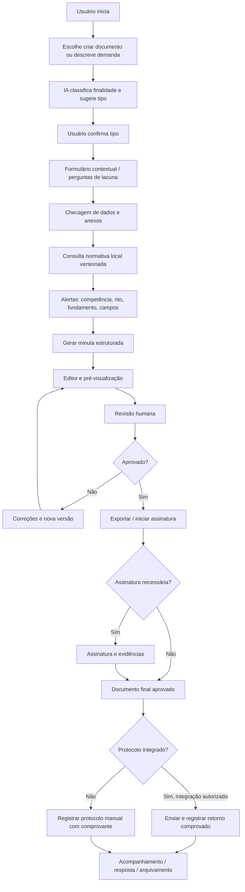

# Gabinete Digital 360° — Estrutura Documental do Vereador
## Análise de documentos reais e proposta de configuração para Januária/MG
**Perfil de referência:** Gabinete do Vereador Edílson Alves dos Santos — Bill do Barreiro / UNIÃO  
**Município:** Januária, Minas Gerais  
**Base documental:** 7 arquivos PDF fornecidos pelo usuário + Lei Orgânica e Regimento Interno mencionados anteriormente.  
**Status:** análise de estrutura e proposta de sistema. A validação normativa final deve ser feita com a versão vigente e pelo jurídico/Secretaria da Câmara.

---

## 1. Objetivo

Transformar os documentos reais de um gabinete em modelos estruturados, reutilizáveis e parametrizáveis no Gabinete Digital 360°, para que o vereador ou assessor:
- selecione o tipo de documento;
- descreva a demanda em linguagem simples;
- responda apenas perguntas complementares necessárias;
- gere uma minuta alinhada à identidade e aos padrões do gabinete;
- confira referências regimentais e alertas;
- revise, aprove, assine e acompanhe o documento.

O sistema não deve copiar erros, informalidades ou inconsistências dos exemplos. Os PDFs são referência de estrutura, estilo, campos e uso, não modelos automaticamente aprovados juridicamente.

## 2. Documentos analisados

### A. Ofício nº 026/2025/GABCMJ/B.B — Indicações ao Executivo
**Data:** 08/12/2025.  
**Destinatário:** Presidente da Câmara, Neiriberto Vieira de Souza, com endereço institucional apresentado.  
**Assunto:** Indicações ao Executivo.  
**Conteúdo:** pedido para encaminhamento ao Prefeito de indicação de torre hidráulica para atender o Departamento Hídrico, contextualizando mais de 500 poços artesianos no município e justificando a melhoria para a equipe técnica e moradores rurais.  
**Assinatura/identificação:** Vereador Bill do Barreiro / UNIÃO.

**Padrão útil:** ofício de encaminhamento à Presidência da Câmara, com assunto, saudação, pedido de encaminhamento ao Executivo, itens da indicação, justificativa, encerramento e identificação do vereador.

### B. Ofício nº 011/2026/GABCMJ/B.B — Solicitação
**Data:** 12/05/2026.  
**Destinatário:** Presidente da Câmara.  
**Assunto:** Solicitação.  
**Conteúdo:** pede encaminhamento ao DER de retirada de ponto de ônibus na BR-135 na comunidade do Alegre e poda de árvores/laterais da rodovia nas imediações do Alegre até Itacarambi.  
**Identificação:** Edílson Alves dos Santos, Vereador Bill do Barreiro / União.

**Padrão útil:** documento com múltiplas providências, destino externo (DER), encaminhamento por meio da Presidência, lista de pedidos e localização geográfica.

### C. Ofício nº 018/2026/GABCMJ/B.B — Voto de Pesar
**Data:** 22/06/2026.  
**Assunto:** Proposição de Voto de Pesar.  
**Conteúdo:** submete à Presidência e ao Plenário proposição de aprovação e encaminhamento de Voto de Profundo Pesar pelo falecimento de Vanderlei Gonçalves da Silva e Zildete Pereira Bezerra, ocorrido em 14/06/2026.  
**Identificação:** Edílson Alves dos Santos, Vereador Bill do Barreiro / UNIÃO.

**Padrão útil:** documento destinado à Presidência/Plenário, com proposição explícita de aprovação e encaminhamento, nomes dos homenageados/falecidos, data do falecimento, mensagem respeitosa, assinatura.

### D. Ofício nº 03/2026/GABCMJ/B.B — Voto de Pesar
**Data:** 12/02/2026.  
**Assunto:** Proposição de Voto de Pesar.  
**Conteúdo:** proposição de Voto de Profundo Pesar pelo falecimento de Ângela Maria de Souza, falecida em 09/02/2026, em Januária/MG.

**Padrão útil:** confirma que Voto de Pesar é uma categoria repetível com campos e template próprios, não apenas texto livre.

### E. Ofício nº 025/2025CMJ/GAB/B.B — Solicitação a Deputado Federal
**Data:** 01/12/2025.  
**Destinatário:** Deputado Federal José Silva (nome conforme documento).  
**Conteúdo:** solicitação de 10 jogos de mesas e 2 tendas 6x6, por meio da Associação Comunitária dos Agricultores Rurais Familiares de São Sebastião e Adjacências, com CNPJ informado de forma incompleta no arquivo; justificativa: conforto e segurança da comunidade.  
**Padrão útil:** ofício de articulação institucional/solicitação de apoio ou equipamento, dirigido a autoridade externa, com entidade beneficiária, identificação/CNPJ, itens/quantidades, objetivo comunitário e agradecimento.

### F. Ofício nº 027/2026CMJ/GAB/B.B — Solicitação a Deputado Federal
**Data:** 21/01/2026.  
**Destinatário:** Deputado Federal José Silva (nome conforme documento).  
**Conteúdo:** solicitação de 10 jogos de mesas e 2 tendas 6x6 via Associação dos Agricultores Familiares Quilombola de Alegre, CNPJ informado, com objetivo de atender a comunidade, proporcionar conforto e segurança.  
**Padrão útil:** confirma template de solicitação de apoio parlamentar com associação beneficiária e pedido material.

### G. Projeto de Decreto Legislativo nº 08/2026 — Mérito Legislativo / Cidadão Honorário
**Data:** 12/06/2026.  
**Objeto:** título de Cidadão Honorário Januarense a Marconi Leonard Lisboa Borges.  
**Fundamentação citada no documento:** art. 39, inciso XIX, da Lei Orgânica Municipal e art. 90, inciso V, alínea “f”, do Regimento Interno (referências conforme arquivo; precisam conferência com versões vigentes).  
**Estrutura:** título/ementa, preâmbulo institucional, artigos do dispositivo, data, autoria, justificativa biográfica detalhada, pedido de apoio dos pares.  
**Dispositivo:** outorga título; prevê entrega em sessão solene em data fixada pela Presidência; materialização em diploma assinado por autoridades competentes; vigência na publicação.  
**Padrão útil:** template separado de Decreto Legislativo de homenagem, com checklist de fundamento, elegibilidade/critério, biografia, contribuição local, diploma, sessão solene, assinaturas e rito.

---

## 3. Tipos documentais confirmados pelos arquivos

| Tipo/Template | Confirmado nos exemplos? | Função |
|---|---:|---|
| Ofício de encaminhamento de indicação | Sim | Solicitar à Presidência encaminhamento de indicação ao Executivo |
| Ofício de solicitação de providências | Sim | Encaminhar pedido a órgão/entidade competente |
| Ofício de proposição de Voto de Pesar | Sim | Submeter proposição à Presidência/Plenário |
| Ofício de solicitação de apoio a deputado | Sim | Pedir recursos, equipamentos ou apoio por associação/comunidade |
| Projeto de Decreto Legislativo de homenagem | Sim | Outorgar título/medalha/honraria |
| Requerimento | A confirmar em novos exemplos | Instrumento de solicitação formal conforme rito local |
| Indicação (proposição separada) | Parcialmente; aparece encaminhada por ofício | Template proposição + template ofício de encaminhamento |
| Projeto de Lei | Não neste lote | Template a construir com base normativa |
| Emenda/Substitutivo | Não neste lote | Template a construir com base normativa |
| Moção/Voto de Pesar | Voto de Pesar confirmado | Outros tipos de moção precisam exemplos/regras |
| Parecer | Não neste lote | Template e workflow de comissão |
| Ofício a órgãos estaduais/federais | Sim, padrão externo | Variação por destinatário e finalidade |

---

## 4. Arquitetura recomendada do catálogo documental

### Categoria 1 — Câmara e trâmite interno
1. Ofício à Presidência para encaminhamento.
2. Proposição de Indicação.
3. Requerimento.
4. Voto de Pesar.
5. Moção.
6. Emenda.
7. Substitutivo.
8. Projeto de Lei.
9. Projeto de Decreto Legislativo.
10. Projeto de Resolução.
11. Parecer.
12. Solicitação de inclusão/encaminhamento (apenas se prevista/validada).

### Categoria 2 — Executivo municipal e órgãos municipais
1. Indicação ao Prefeito.
2. Solicitação de providências.
3. Pedido de informações.
4. Solicitação de documentos/cópias.
5. Ofício para Secretaria Municipal.
6. Solicitação de vistoria/serviço.
7. Relatório de fiscalização e encaminhamento.
8. Relatório de visita.

### Categoria 3 — Órgãos estaduais/federais
1. Ofício ao DER/MG ou órgão estadual.
2. Ofício a concessionária/entidade competente (configurável).
3. Ofício a deputado estadual.
4. Ofício a deputado federal.
5. Ofício a senador.
6. Solicitação de apoio, recurso, equipamento, emenda ou articulação.
7. Encaminhamento de demanda comunitária.
8. Pedido de agenda/reunião.

### Categoria 4 — Comunidade, associações e entidades
1. Solicitação por entidade beneficiária.
2. Apoio a associação rural/comunitária.
3. Documento de encaminhamento de demanda.
4. Relatório de reunião comunitária.
5. Relatório de visita e escuta.
6. Termo/resumo de compromisso (não confundir com obrigação formal sem validação).
7. Carta de agradecimento.

### Categoria 5 — Homenagens e solenidades
1. Voto de Pesar.
2. Moção de Congratulação.
3. Moção de Aplauso.
4. Título de Cidadão Honorário.
5. Mérito Legislativo.
6. Medalha/Comenda.
7. Diploma.
8. Convite e roteiro de sessão solene.
9. Justificativa biográfica.
10. Ata/resumo de entrega, conforme fluxo oficial.

### Categoria 6 — Fiscalização
1. Relatório de visita.
2. Relatório de obra.
3. Relatório de serviço público.
4. Relatório de acompanhamento de demanda.
5. Pedido de informações.
6. Requisição/solicitação de cópias.
7. Encaminhamento de denúncia/reclamação.
8. Matriz de acompanhamento de resposta.

---

## 5. Campos e formulários inteligentes por família

### A. Indicação / Solicitação de providências
- Problema observado;
- Comunidade/bairro/localidade;
- Endereço ou ponto de referência;
- Órgão responsável;
- Providência desejada;
- Beneficiários;
- Urgência (classificação interna, sem prometer prazo);
- Contexto;
- Justificativa/interesse público;
- Evidências (fotos, documentos, localização);
- Autor;
- Destinatário e encaminhamento;
- Norma/rito local associado (verificado ou pendente);
- Anexos.

### B. Voto de Pesar
- Nome completo;
- Data do falecimento;
- Local do falecimento (opcional);
- Vínculo com Januária/comunidade (opcional, sem inventar);
- Família/destinatários (se houver);
- Mensagem;
- Pedido formal: aprovação e encaminhamento;
- Rito/órgão destinatário conforme Regimento;
- Assinatura;
- Conferência de grafia e dados.

### C. Ofício de apoio a deputado/autoridade
- Autoridade destinatária;
- Cargo;
- Gabinete/órgão;
- Município/UF;
- Tipo de apoio;
- Item solicitado;
- Quantidade;
- Especificação;
- Associação/entidade beneficiária;
- CNPJ;
- Representante da entidade;
- Comunidade;
- Problema/necessidade;
- Beneficiários estimados (se fornecidos);
- Objetivo;
- Justificativa;
- Anexos (ofício da associação, orçamento, fotos, documentação, quando aplicável);
- Pedido de retorno/acompanhamento;
- Assinatura do vereador.

**Validação:** CNPJ deve ser validado e armazenado completo; não inferir dígitos ausentes. Confirmar se o apoio é solicitado em nome do vereador, associação ou comunidade, e evitar sugerir que recurso/benefício foi aprovado.

### D. Projeto de Decreto Legislativo — Honraria
- Tipo de honraria;
- Nome do homenageado;
- Biografia;
- Naturalidade/data de nascimento (se houver);
- Vínculo com Januária;
- Serviços/contribuições prestados;
- Evidências/fontes da biografia;
- Critérios de elegibilidade;
- Fundamento normativo (artigos verificados);
- Ementa;
- Dispositivo;
- Sessão solene e entrega;
- Diploma;
- Vigência;
- Justificativa;
- Autoria;
- Coautoria/subscrições;
- Checklist de rito, comissão, votação e quórum (a confirmar com normas locais).

---

## 6. Modelos de documentos derivados dos exemplos

### Template 1 — Ofício de encaminhamento de Indicação
**Cabeçalho:** Câmara Municipal de Januária / Gabinete do Vereador [Nome].  
**Número:** [número oficial, somente se atribuído].  
**Data:** [data].  
**Destinatário:** Presidente da Câmara.  
**Assunto:** Encaminhamento de Indicação ao Executivo.  
**Abertura:** cumprimento e solicitação de encaminhamento na forma regimental.  
**Corpo:** indicação(s) enumerada(s), órgão destinatário, ação desejada, localização e justificativa.  
**Fechamento:** agradecimento/respeitosamente.  
**Assinatura:** vereador, nome parlamentar, partido opcional conforme template.

### Template 2 — Ofício de Solicitação / Providência
- Destinatário interno (Presidência) e destino externo (DER, Secretaria, Prefeito, etc.);
- Assunto específico;
- Solicitação numerada;
- Localização;
- Descrição factual;
- Providência desejada;
- Justificativa;
- Encaminhamento regimental;
- Anexos;
- Assinatura.

### Template 3 — Proposição de Voto de Pesar
- Número/data;
- Destinatário: Presidente da Câmara;
- Assunto: Proposição de Voto de Pesar;
- Texto formal submetendo à consideração da Presidência/Plenário;
- Nome(s) da(s) pessoa(s);
- Data do falecimento;
- Mensagem de pesar;
- Pedido de aprovação e encaminhamento;
- Assinatura.

### Template 4 — Ofício a deputado / autoridade externa
- Autoridade e cargo;
- Ofício e data;
- Saudação;
- Contextualização e reconhecimento institucional (opcional, sem exageros automáticos);
- Solicitação clara e enumerada;
- Entidade beneficiária;
- CNPJ validado;
- Especificações e quantidade;
- Objetivo e justificativa;
- Beneficiários/território, se informado;
- Pedido de colaboração/retorno;
- Fechamento;
- Assinatura.

### Template 5 — Projeto de Decreto Legislativo de Honraria
- Ementa;
- Preâmbulo com Câmara, fundamento e fórmula de aprovação/promulgação conforme norma;
- Art. 1º: concessão e homenageado;
- Art. 2º: sessão/entrega;
- Art. 3º: diploma e assinaturas;
- Art. 4º: vigência, se aplicável conforme modelo e regra;
- Local/data;
- Autor;
- Justificativa biográfica;
- Evidências;
- Checklist jurídico/regimental.

---

## 7. Identidade visual e dados de gabinete extraídos

A identidade visual apresentada nos PDFs inclui:
- Logo/brasão da Câmara Municipal de Januária;
- Marca/identificação “Gabinete do Vereador Bill do Barreiro”;
- Nome parlamentar em destaque;
- Elementos gráficos e marca d’água municipal;
- Layout institucional com cabeçalho, número/data, destinatário, assunto, corpo, encerramento e assinatura.

**Recomendação de produto:** identidade visual não deve ficar fixa no código. Criar `office_branding_profile` com uploads e opções:
- logo institucional;
- logo/assinatura visual do gabinete;
- marca d’água;
- cabeçalho e rodapé;
- fontes e tamanhos;
- margens;
- espaçamento;
- posição da assinatura;
- templates específicos por tipo;
- versões de branding e histórico.

O sistema deve permitir usar marca institucional oficial de acordo com regras de uso, evitando uso indevido ou alteração do brasão.

---

## 8. Campos universais de documento

- ID interno;
- Município e órgão;
- Gabinete;
- Legislatura;
- Sessão legislativa;
- Vereador autor;
- Coautores/subscritores;
- Tipo e subtipo;
- Número oficial (não autoatribuir se o processo oficial não estiver integrado);
- Data;
- Destinatário;
- Cargo/órgão destinatário;
- Assunto;
- Texto;
- Justificativa;
- Fundamentação normativa e citações;
- Anexos;
- Evidências;
- Revisores;
- Aprovador;
- Assinantes;
- Status;
- Versões;
- Hash do arquivo final;
- Protocolo (número, data, canal, comprovante);
- Histórico de eventos;
- Classificação de privacidade;
- Política de retenção.

---

## 9. Workflow recomendado

`created → collecting_information → draft_generated → ai_checks → human_review → approved → signature_pending → signed → protocol_ready → protocol_submitted → protocol_confirmed → archived`

Estados alternativos:
- `needs_more_information`;
- `returned_for_changes`;
- `rejected`;
- `cancelled`;
- `expired`;
- `signature_failed`;
- `protocol_failed`.

O sistema não pode marcar “protocolado” sem confirmação ou integração real. Número oficial não deve ser inventado. A IA não pode inserir assinatura manuscrita digitalizada como se fosse assinatura digital.

---

## 10. Inteligência e verificações

### Verificações automáticas
- Nome do vereador e cargo consistentes;
- Nome do destinatário e órgão;
- Datas;
- Número de documento sem duplicidade (quando numeração gerenciada);
- CNPJ com validação de formato/dígitos;
- Quantidade e especificações;
- Localidade e ponto de referência;
- Campos obrigatórios;
- Grafia de nomes;
- Referências legais existentes no corpus vigente;
- Rito e competência com alertas;
- Tom/formalidade;
- Duplicidade de solicitações;
- Coerência entre pedido e justificativa;
- Verificação de texto vazio ou ambíguo;
- Confirmação de anexos.

### Painel de alertas
- **Crítico:** possível competência/iniciativa inadequada, artigo não confirmado, destinatário errado, documento sem informação indispensável.
- **Alto:** CNPJ incompleto, conflito de datas, nome inconsistente, ausência de anexos necessários.
- **Médio:** justificativa fraca, solicitação ampla, linguagem ambígua.
- **Informativo:** oportunidade de melhorar clareza, concisão, organização.

Cada alerta deve exibir fonte, motivo, ação recomendada e status: aberto, resolvido, dispensado com justificativa.

---

## 11. Modelo de dados sugerido

### Configuração
- `municipal_jurisdiction_profiles`
- `normative_sources`
- `normative_articles`
- `jurisdiction_rules`
- `legislatures`
- `municipal_orgs`
- `council_members`
- `council_parties`
- `council_committees`
- `office_profiles`
- `office_branding_profiles`
- `document_type_catalog`
- `document_templates`
- `document_template_versions`
- `template_fields`
- `document_workflows`

### Documentos
- `parliamentary_documents`
- `document_versions`
- `document_generation_sessions`
- `document_citations`
- `document_attachments`
- `document_evidence`
- `document_reviews`
- `document_signatures`
- `document_protocol_records`
- `document_alerts`
- `document_event_logs`

### Entidades comunitárias/beneficiárias
- `community_entities`
- `associations`
- `beneficiary_communities`
- `external_authorities`
- `recipient_directory`
- `requests_and_followups`

RLS: tenant/org e gabinete segregados; vereadores só acessam seus documentos e os compartilhados conforme permissões. Dados sensíveis de denúncias/reclamações devem ficar em módulo segregado, não no CRM geral.

---

## 12. Tela do sistema: “Central de Documentos”

### Entrada
- Criar documento;
- Modelos favoritos;
- Documentos recentes;
- Pendências de revisão;
- Assinaturas pendentes;
- Protocolo/acompanhamento;
- Pesquisa por número, assunto, destinatário, comunidade, entidade ou tipo.

### Wizard de geração
1. Selecionar categoria.
2. Selecionar documento.
3. Descrever a solicitação.
4. IA identifica dados faltantes e pergunta somente o necessário.
5. Formulário contextual.
6. Prévia da minuta.
7. Painel de fontes/alertas.
8. Editar.
9. Revisar/aprovar.
10. Exportar, assinar e acompanhar.

### Dashboard
- Documentos por tipo;
- Pedidos enviados;
- Respostas recebidas;
- Solicitações em aberto;
- Documentos aguardando assinatura;
- Documentos aguardando protocolo;
- Prazo de retorno (somente quando prazo normativo/administrativo confiável for cadastrado);
- Demandas por comunidade;
- Apoios solicitados e status (solicitado, em análise, aprovado, negado, entregue — status comprovados).

---

## 13. Inovação recomendada — “Documento 360”

Cada documento terá uma página de acompanhamento com:
- Texto e versões;
- Fonte normativa;
- Alertas;
- Evidências e anexos;
- Revisões;
- Assinaturas;
- Protocolo;
- Destinatário;
- Status;
- Retornos;
- Histórico;
- Próximas ações.

A IA pode sugerir:
- melhor instrumento documental;
- perguntas para completar a solicitação;
- melhoria de justificativa;
- texto mais objetivo;
- possíveis anexos;
- destinatário/órgão a confirmar;
- lembrete de acompanhamento;
- documento relacionado (ex.: indicação → ofício de encaminhamento → resposta → relatório).

---

## 14. Prioridade de implementação

### P0 — Base documental real
1. Perfil do vereador/gabinete e branding.
2. Central de documentos.
3. Ofício de indicação.
4. Ofício de solicitação/providência.
5. Voto de Pesar.
6. Ofício a deputado/autoridade.
7. PDL de honraria.
8. Formulários contextualizados.
9. Versionamento, revisão e exportação.
10. Dados de destinatários e entidades.
11. Acompanhamento de solicitações.

### P1 — Catálogo legislativo
1. Requerimento.
2. Pedido de informações.
3. Projeto de Lei.
4. Emenda/Substitutivo.
5. Moções.
6. Parecer.
7. Resolução.
8. Relatórios de fiscalização.
9. Visitas e audiências.

### P2 — Inteligência
1. Legal Context Engine.
2. Pesquisa normativa com citações.
3. Comparação de documentos.
4. Analytics.
5. Acompanhamento de respostas.
6. Protocolo integrado (apenas se API/integração autorizada).
7. Geração de pacotes documentais.

---

## 15. Regras de produto para evitar problemas

1. Não inventar número de documento, protocolo, prazo, nome, CNPJ ou data.
2. Todo texto gerado deve ser marcado como minuta até aprovação.
3. Citações legais devem ser verificadas no documento/versionamento normativo.
4. O sistema deve indicar “fonte não confirmada” se não tiver certeza.
5. Assinatura e protocolo só mudam o status após evidência real.
6. Documentos de homenagem exigem conferência de critérios e rito.
7. Solicitações de recursos/equipamentos devem registrar entidade beneficiária e documentação de apoio; não sugerir aprovação garantida.
8. Dados pessoais de falecidos/famílias e entidades devem ser tratados com minimização e cuidado.
9. O gabinete pode customizar templates sem alterar a base jurídica municipal.
10. Toda alteração de template/norma deve ter versão, responsável e histórico.

---

## 16. Conclusão

Os sete arquivos mostram que a rotina documental real do gabinete é mais ampla do que um gerador de “ofício”. Ela inclui encaminhamento regimental, solicitações a órgãos, articulação com deputados, demandas comunitárias, votos de pesar e proposições de honrarias.

A proposta é estruturar o Gabinete Digital 360° com um **Catálogo Documental orientado por fluxos**, e não apenas uma coleção de modelos Word/PDF.

Januária será configurada com:
- perfil jurídico municipal;
- perfil da Câmara;
- perfil do gabinete/vereador;
- identidade visual;
- catálogo de documentos;
- formulários por finalidade;
- templates versionados;
- regras e alertas;
- workflow de revisão;
- assinatura;
- protocolo e acompanhamento.

### Fontes
- PDFs fornecidos: Ofício 026/2025 (indicações), Ofício 011/2026 (solicitações ao DER), Ofícios 018/2026 e 03/2026 (votos de pesar), Ofícios 025/2025 e 027/2026 (solicitações a deputado federal), PDL 08/2026 (Cidadão Honorário/Mérito Legislativo).
- SAPL — Lei Orgânica de Januária: https://sapl.januaria.mg.leg.br/ta/5/text?print
- SAPL — Regimento Interno de Januária: https://sapl.januaria.mg.leg.br/ta/28/text?print

---

# PARTE II — CONFIGURAÇÃO NORMATIVA MUNICIPAL, REQUISITOS E ESPECIFICAÇÃO DE IMPLEMENTAÇÃO

## 17. Base normativa municipal analisada

### 17.1 Lei Orgânica Municipal

Foi analisado o arquivo **Lei Orgânica Municipal nº 1, de 07 de julho de 1990**, disponibilizado no SAPL da Câmara Municipal de Januária, cuja impressão informa alterações posteriores, incluindo Emenda à Lei Orgânica nº 22, de 18 de junho de 2024, e vigência indicada a partir de 18/06/2024.

**Referência oficial consultada:** https://sapl.januaria.mg.leg.br/ta/5/text?print

Artigos relevantes para a configuração documental (resumo funcional, não substitui leitura integral):

| Dispositivo | Conteúdo relevante para o sistema | Consequência de produto |
|---|---|---|
| Art. 19 | O Poder Legislativo municipal é exercido pela Câmara Municipal | Identificar órgão, Câmara, gabinete e autor institucional corretamente |
| Art. 20 | Composição da Câmara por vereadores eleitos e mandato | Perfil do vereador, legislatura e mandato configuráveis |
| Arts. 21–26 | Sessões, deliberações, publicidade e condições de funcionamento | Configuração de sessão e contexto de tramitação; não automatizar decisão de quórum sem validação |
| Arts. 27–30 | Instalação, Mesa e comissões | Cadastro de legislatura, Mesa e comissões |
| Arts. 31–32 | Lideranças e matérias do Regimento | Cadastro de bancadas/blocos e uso do Regimento como fonte detalhada |
| Arts. 33–35 | Convocação/comparecimento e outras atividades institucionais | Modelos de convocação e comparecimento somente conforme rito validado |
| Arts. 36–37 | Atribuições da Mesa e Presidência | Distinguir ato/documento do vereador de ato reservado à Mesa/Presidência |
| Art. 38 | Competência legislativa municipal | Motor de contexto de competência e alertas de iniciativa |
| Art. 39 | Competências privativas da Câmara | Catálogo de matérias e instrumentos próprios da Câmara, com revisão jurídica |
| Arts. 40–44 | Garantias, vedações, perda de mandato, licença e suplência | Evitar documentos ou ações que impliquem decisão automática sobre status parlamentar |
| Art. 45 | Processo legislativo municipal: instrumentos e fases | Catálogo legislativo e fluxo de proposições |
| Arts. 46–52 | Emenda à Lei Orgânica, iniciativa, leis complementares, iniciativa reservada, urgência e sanção | Regras de iniciativa, tipos de lei, etapas e alerta de competência |
| Art. 49 | Iniciativa exclusiva do Prefeito em matérias descritas no artigo | Red-flag de iniciativa; bloquear conclusão automática e encaminhar para jurídico |
| Art. 50 | Iniciativa exclusiva da Mesa em matérias descritas | Red-flag para propostas de vereador que possam invadir iniciativa da Mesa |
| Art. 53 | Projetos de resolução para matérias internas; decretos legislativos para matérias de competência da Câmara que independam de sanção | Classificar instrumento legislativo; validar objeto e rito |
| Art. 55 | Fiscalização contábil, financeira e orçamentária | Módulo de fiscalização e evidências, com escopo de competência |

**Observação:** a tabela resume pontos relevantes identificados. A extração do PDF e o texto oficial devem ser conferidos artigo a artigo, especialmente alterações, redações consolidadas, exceções, quóruns, prazos e competências específicas antes de codificar regras impeditivas.

### 17.2 Regimento Interno

Foi analisado o arquivo **Regimento Interno nº 1, de 21 de dezembro de 1990**, disponibilizado no SAPL. O cabeçalho indica alterações por resoluções posteriores, incluindo a Resolução nº 2, de 12 de agosto de 2024, e vigência indicada a partir de 23/08/2022.

**Referência oficial consultada:** https://sapl.januaria.mg.leg.br/ta/28/text?print

Dispositivos com impacto direto na arquitetura e nos fluxos:

| Dispositivo | Relevância documental / funcional |
|---|---|
| Arts. 1–6 | Composição, sede, instalação, posse e formalidades da legislatura; cadastro da legislatura e perfil parlamentar |
| Arts. 21–41 | Sessões, calendário, reuniões, expediente, proposições, ordem do dia, atas e procedimentos; agenda legislativa e status de tramitação devem ser configuráveis |
| Arts. 43–60 | Direitos, deveres, licenças, vacância, suplência e consequências; perfil e status não podem ser alterados por IA |
| Arts. 69–74 | Lideranças e blocos; cadastro de bancada, líder e vice-líder com vigência |
| Arts. 75–88 | Mesa Diretora, atribuições e Secretaria; regras de autoria, encaminhamento, assinatura e competência institucional |
| Arts. 89–96 | Plenário, atribuições e regras de reunião; fluxo de deliberação não deve ser presumido a partir da minuta |
| Arts. 97–118 | Comissões permanentes e temporárias, composição, competência e funcionamento; encaminhamento a comissão e pareceres |
| Arts. 120 e seguintes | Regras de proposições e procedimentos legislativos a estruturar no motor de fluxo, após validação detalhada |
| Arts. 154–155 (conforme versão/extração e referência anterior) | Formas e requisitos de proposições; texto claro, técnica e compatibilidade normativa; confirmar numeração e redação consolidada antes de configurar regra automática |
| Arts. 184–187 | Projetos de resolução e promulgação, conforme texto extraído; modelo e workflow próprios |
| Arts. 188–193 | Proposta de emenda à Lei Orgânica, dois turnos, interstício, distribuição, discussão e promulgação; fluxo especial |
| Arts. 194–200 | Projetos orçamentários e procedimentos específicos; modelos de orçamento/financeiro com regra especial e revisão jurídica |
| Art. 201 | Projetos de resolução de título de cidadania honorária: comissão e procedimento especial indicado no artigo; checklist de honraria |
| Arts. 208–214 | Decreto legislativo, emenda e substitutivo; templates distintos e vínculos com proposição principal |
| Arts. 215–217 | Requerimentos escritos/orais e matérias submetidas a despacho ou votação; catalogar requerimento por finalidade e rito |
| Arts. 218–236 | Discussão, votação, processos de votação e regras correlatas; não simular resultado, quórum ou votação sem dados oficiais |
| Arts. 237–242 | Redação final, ordem/preferência, prejudicialidade e retirada; estados de tramitação e eventos auditáveis |
| Arts. 243–250 | Convocação e pedidos de informações/comparecimento; templates de requerimento/ofício e workflow institucional |
| Arts. 256–261 | Serviços administrativos, certidões, acesso dos vereadores a livros/documentos, registros e prazos; trilha de auditoria e gestão documental |

**Limitação importante:** o sistema deve armazenar a norma consolidada e cada artigo como fonte/versionamento. Esta especificação não declara que todos os artigos citados estejam integralmente transcritos nem que as referências estejam juridicamente validadas. Conferência final com o texto oficial e jurídico/Secretaria é requisito de implantação.

## 18. Matriz de regras normativas para o motor de contexto

A base municipal não deve ser tratada como um único prompt. Ela deve ser estruturada em fontes, artigos, regras, parâmetros, vigência e status de revisão.

### 18.1 Campos por fonte normativa

- `source_id`;
- nome/tipo da norma;
- número e ano;
- órgão emissor;
- URL oficial;
- arquivo-fonte;
- versão/consolidação;
- data de publicação;
- vigência inicial/final, quando conhecida;
- emendas/alterações relacionadas;
- checksum do arquivo;
- data da captura;
- status de revisão jurídica (`unreviewed`, `review_pending`, `approved`, `superseded`, `invalidated`);
- responsável pela revisão;
- notas de interpretação.

### 18.2 Campos por artigo/dispositivo

- fonte normativa;
- número do artigo;
- parágrafo;
- inciso;
- alínea;
- texto integral;
- resumo funcional separado do texto literal;
- assuntos/tags;
- instrumento relacionado;
- competência/iniciativa;
- quórum/prazo, se expressamente verificado;
- exceções;
- vigência;
- link direto;
- estado de validação jurídica.

### 18.3 Regra de segurança jurídica do produto

A IA pode **sugerir** fundamento e apontar possíveis incompatibilidades. Não pode declarar definitivamente que a proposição é constitucional, legal, regimentalmente admissível ou aprovada. Alertas devem ser classificados e fundamentados em fonte, artigo, trecho e versão.

## 19. Catálogo documental consolidado — versão de configuração

### 19.1 Documentos confirmados nos exemplos

| ID sugerido | Documento | Categoria | Modelo-base | Evidência |
|---|---|---|---|---|
| `OFFICE_INDICATION_FORWARD` | Ofício de encaminhamento de Indicação ao Executivo | Câmara/Executivo | Ofício 026/2025 | Confirmado |
| `OFFICE_REQUEST_FORWARD` | Ofício de solicitação/encaminhamento de providências | Câmara/órgão externo | Ofício 011/2026 | Confirmado |
| `OFFICE_VOTE_CONDOLENCE` | Ofício de proposição de Voto de Pesar | Câmara/homenagem | Ofícios 03/2026 e 018/2026 | Confirmado |
| `OFFICE_EXTERNAL_SUPPORT_FED` | Ofício a Deputado Federal para apoio/equipamento | Articulação | Ofício 025/2025 | Confirmado |
| `OFFICE_EXTERNAL_SUPPORT_STATE` | Ofício a Deputado Estadual | Articulação | Arquivo de 2026 | Confirmado |
| `PDL_HONORARY_CITIZEN` | Projeto de Decreto Legislativo — Cidadão Honorário/Mérito | Proposição | PDL 08/2026 | Confirmado |

### 19.2 Documentos propostos — dependem de validação regimental/template

#### Câmara e processo legislativo
- Indicação (proposição autônoma);
- Requerimento de despacho;
- Requerimento submetido ao Plenário;
- Pedido de informações;
- Pedido de documentos/certidões;
- Projeto de Lei ordinária;
- Projeto de Lei complementar;
- Emenda a projeto;
- Substitutivo;
- Projeto de Decreto Legislativo;
- Projeto de Resolução;
- Emenda à Lei Orgânica;
- Parecer de comissão;
- Relatório de comissão;
- Relatório de fiscalização;
- Moção de aplauso/congratulação;
- Voto de pesar;
- Requerimento de convocação, quando aplicável;
- Requerimento de audiência/reunião, quando aplicável;
- Redação final.

#### Prefeitura e órgãos municipais
- Solicitação de providências;
- Indicação de serviço ou obra;
- Pedido de informações;
- Pedido de cópias/documentos;
- Pedido de vistoria;
- Encaminhamento de demanda;
- Relatório de visita;
- Relatório de fiscalização;
- Relatório de acompanhamento de obra/serviço.

#### Órgãos estaduais, federais e autoridades
- Ofício a Deputado Estadual;
- Ofício a Deputado Federal;
- Ofício a Senador;
- Ofício a Governador/Secretaria;
- Ofício ao DER/MG ou outro órgão técnico;
- Pedido de apoio institucional;
- Pedido de equipamentos;
- Pedido de recursos/emenda (sem prometer destinação/resultado);
- Pedido de agenda;
- Pedido de reunião;
- Encaminhamento de demanda de comunidade/entidade.

#### Comunidades e entidades
- Ofício de apoio a associação;
- Encaminhamento de demanda coletiva;
- Relatório de reunião comunitária;
- Relatório de visita;
- Registro de compromisso (somente como registro, não como instrumento contratual sem revisão);
- Carta de agradecimento;
- Resumo de acompanhamento de demanda.

#### Homenagens e eventos
- Voto de Pesar;
- Moção de Aplauso;
- Moção de Congratulação;
- Título de Cidadão Honorário;
- Mérito Legislativo;
- Medalha/Comenda (se instituída e normativamente prevista);
- Diploma;
- Convite;
- Roteiro de sessão solene;
- Justificativa/biografia do homenageado.

**Regra:** itens propostos não serão ativados como modelos oficiais até que se verifique a norma, o rito, os campos, o órgão competente, assinaturas e eventuais quóruns.

## 20. Formulários inteligentes — especificação por tipo

### 20.1 Formulário universal de entrada (conversa com IA)

1. O que você precisa fazer ou solicitar?
2. Quem é o destinatário ou órgão responsável, se souber?
3. Onde ocorre a demanda?
4. Quem é afetado/beneficiado?
5. Qual providência você deseja?
6. Por que isso é importante?
7. Há fatos, datas, protocolos, fotos ou documentos?
8. Há algum prazo ou urgência? Qual a origem desse prazo?
9. O pedido é individual, comunitário, institucional ou fiscalização?
10. O usuário quer criar um documento, registrar uma demanda, acompanhar uma demanda existente ou gerar pacote de documentos?

A IA deverá identificar a categoria, mostrar sua escolha e permitir troca manual antes de gerar a minuta.

### 20.2 Indicação / solicitação de providências

**Campos obrigatórios (configuráveis por rito):** problema, local, providência, destinatário/órgão ou “a confirmar”, justificativa factual, autor, data.  
**Campos opcionais:** bairro/comunidade, rua/trecho, ponto de referência, coordenadas, beneficiários, urgência, fotos, anexos, protocolos anteriores, contato comunitário.  
**Validações:** endereço/localização minimamente identificável; pedido de ação claro; evitar destinatário presumido; separar fato observado de alegação; anexos disponíveis; checar competência de órgão como sugestão e pedir confirmação.

### 20.3 Voto de Pesar

- Nome completo;
- Grafia conferida;
- Data de falecimento;
- Município/local, se informado;
- Destinatário/órgão de encaminhamento;
- Familiares/destinatários (opcional e minimizado);
- Mensagem de pesar;
- Autor;
- Data;
- Informações adicionais (opcional).

**Validação:** não inventar vínculo, profissão, história ou parentesco. Confirmar data e nome. Tom respeitoso e não partidário. Evitar dados pessoais desnecessários.

### 20.4 Ofício de apoio a autoridade

- Tipo de autoridade;
- Nome e cargo;
- Órgão/gabinete;
- Endereço institucional (se utilizado);
- Assunto;
- Beneficiário;
- Entidade;
- CNPJ completo;
- Representante da entidade;
- Comunidade/localidade;
- Item/equipamento/serviço;
- Quantidade;
- Especificação;
- Valor estimado (se informado, com fonte);
- Justificativa;
- Beneficiários estimados (apenas se informado/validado);
- Objetivo/resultado esperado;
- Anexos;
- Pedido de resposta/acompanhamento.

**Validação:** CNPJ formatado e dígitos verificadores; nome legal da entidade e CNPJ não devem ser inferidos; quantidades e especificações devem ser confirmadas; separar solicitação de aprovação/entrega.

### 20.5 Projeto de Decreto Legislativo — honraria

- Tipo de honraria;
- Nome completo do homenageado;
- Nome social, quando aplicável e autorizado;
- Biografia;
- Data/local de nascimento (se necessário e autorizado);
- Naturalidade;
- Profissão;
- Vínculo com Januária;
- Contribuições/serviços prestados;
- Datas e evidências;
- Critérios de elegibilidade;
- Artigos/fundamento legal;
- Ementa;
- Dispositivo;
- Sessão/entrega;
- Diploma;
- Autoria/coautoria/subscrições;
- Justificativa;
- Anexos;
- Comissão e rito (a validar).

**Validação:** comprovar critérios exigidos pela norma; fundamentação deve vir de fonte normativa vigente e revisada; biografia deve distinguir fatos documentados de relato fornecido; revisar nomes/datas; não inserir automaticamente promessa de sessão, assinatura ou publicação.

### 20.6 Pedido de informações/fiscalização

- Autoridade destinatária;
- Objeto e pergunta(s) numerada(s);
- Período abrangido;
- Unidade/serviço;
- Base de contexto;
- Justificativa fiscalizatória;
- Documentos esperados;
- Prazo normativo (apenas se verificado);
- Fonte de prazo;
- Forma de resposta;
- Referência a demanda anterior;
- Evidências/anexos.

**Validação:** perguntas claras e delimitadas; prazo não inventado; verificar instrumento e rito local; alertar sobre dados pessoais, informações sigilosas e escopo.

### 20.7 Relatório de visita/fiscalização

- Tipo de visita;
- Data/hora;
- Local;
- Participantes;
- Objetivo;
- Observações factuais;
- Relatos atribuídos à fonte;
- Fotos/anexos;
- Problemas observados;
- Providências sugeridas;
- Demandas registradas;
- Próximo passo;
- Responsável pelo acompanhamento.

**Validação:** diferenciar observação direta, informação recebida e conclusão; identificar anexos; não declarar irregularidade definitiva sem avaliação adequada.

## 21. Templates propostos — estrutura editorial

### 21.1 Template: Ofício de encaminhamento de Indicação

1. Cabeçalho institucional (configuração do gabinete/Câmara);
2. Número oficial (apenas se atribuído pelo processo oficial);
3. Data e local;
4. Destinatário (Presidência ou órgão competente, conforme rito);
5. Assunto;
6. Saudação;
7. Texto de encaminhamento;
8. Lista numerada de indicação(ões), cada uma com título, local, providência e justificativa;
9. Pedido de encaminhamento;
10. Fechamento;
11. Autor/assinatura;
12. Anexos, se houver.

### 21.2 Template: Ofício de solicitação de providências

1. Cabeçalho;
2. Número/data;
3. Destinatário e encaminhamento;
4. Assunto;
5. Contexto;
6. Providência(s) numerada(s);
7. Local/trecho;
8. Justificativa;
9. Pedido de encaminhamento/resposta;
10. Fechamento e assinatura;
11. Anexos.

### 21.3 Template: Voto de Pesar

1. Cabeçalho;
2. Número/data;
3. Destinatário;
4. Assunto “Proposição de Voto de Pesar”;
5. Texto de submissão à consideração da Presidência/Plenário (conforme modelo/rito validado);
6. Nome(s), data e informações verificadas;
7. Manifestação de pesar;
8. Pedido de aprovação/encaminhamento, conforme rito;
9. Fechamento;
10. Autor/assinatura.

### 21.4 Template: Solicitação de apoio a autoridade

1. Destinatário, cargo e órgão;
2. Número/data/identificação;
3. Saudação;
4. Contextualização institucional concisa;
5. Solicitação específica e itemizada;
6. Beneficiário/entidade/CNPJ;
7. Localidade;
8. Quantidade/especificação;
9. Justificativa e objetivo;
10. Pedido de apoio e retorno;
11. Fechamento;
12. Autor/assinatura;
13. Anexos.

### 21.5 Template: Projeto de Decreto Legislativo de honraria

1. Identificação do projeto/número (atribuição oficial);
2. Ementa;
3. Preâmbulo/fórmula de aprovação, de acordo com template aprovado;
4. Fundamentação legal;
5. Artigo 1º — concessão e identificação;
6. Artigo 2º — entrega/sessão, se juridicamente apropriado e aprovado;
7. Artigo 3º — diploma e assinaturas, conforme regra;
8. Artigo de vigência, se aplicável;
9. Local/data;
10. Autor;
11. Justificativa;
12. Biografia/evidências;
13. Checklist de elegibilidade, comissão, votação, quórum e rito.

### 21.6 Template: Pedido de informações

1. Cabeçalho e identificação;
2. Destinatário;
3. Assunto;
4. Fundamentação/instrumento regimental validado;
5. Contexto objetivo;
6. Perguntas numeradas e delimitadas;
7. Documentos solicitados;
8. Período;
9. Prazo, se verificado;
10. Forma de resposta;
11. Autor/assinatura;
12. Anexos.

### 21.7 Template: Relatório de fiscalização/visita

1. Identificação;
2. Data e local;
3. Objetivo;
4. Participantes;
5. Observações;
6. Evidências;
7. Relatos recebidos com atribuição;
8. Demandas;
9. Recomendações/encaminhamentos;
10. Responsável e prazo de acompanhamento;
11. Anexos.

## 22. Fluxo completo de geração

## 23. Workflow e estados

### 23.1 Documento

- `created` — criado;
- `intake` — coleta de contexto;
- `needs_information` — faltam dados;
- `classified` — tipo documental confirmado;
- `draft_generated` — minuta gerada;
- `validation_pending` — verificações pendentes;
- `review` — revisão humana;
- `changes_requested` — correções solicitadas;
- `approved` — aprovado por responsável;
- `signature_pending` — assinatura pendente;
- `signed` — assinatura concluída e evidências;
- `ready_to_protocol` — pronto para protocolo;
- `protocol_submitted` — envio/protocolo registrado;
- `protocol_confirmed` — protocolo confirmado por evidência;
- `awaiting_response` — aguardando resposta;
- `responded` — resposta registrada;
- `completed` — concluído;
- `archived` — arquivado;
- `cancelled` — cancelado.

### 23.2 Estados de alertas

- `open`;
- `resolved`;
- `dismissed_with_reason`;
- `reopened`.

### 23.3 Regras

- A minuta não é documento oficial aprovado;
- `approved` exige responsável e timestamp;
- `signed` exige evidência de assinatura;
- `protocol_confirmed` exige número/recibo/registro oficial;
- IA nunca preenche protocolo fictício;
- alteração após assinatura cria novo documento/versionamento, não substitui silenciosamente o arquivo assinado;
- toda mudança de status gera evento de auditoria.

## 24. Regras de validação

### 24.1 Validação universal

- Campos obrigatórios do template preenchidos;
- Nome e cargo do autor consistentes com perfil vigente;
- Município/órgão correto;
- Data coerente;
- Destinatário identificável;
- Assunto específico;
- Pedido/objetivo claro;
- Texto sem placeholder residual;
- Anexos listados;
- Número oficial não inventado;
- Referências legais com fonte e versão;
- Assinaturas e protocolo não simulados;
- Dados pessoais minimizados;
- Documento e versão identificados.

### 24.2 Validação jurídica/regimental

Alertas (não conclusões automáticas):
- possível competência fora do âmbito municipal;
- possível iniciativa reservada;
- instrumento legislativo talvez inadequado;
- necessidade de comissão;
- rito especial;
- quórum/interstício/prazo a verificar;
- fundamento legal desatualizado ou não validado;
- destinatário que pode não ser competente;
- texto que cria obrigação, despesa ou política sem análise;
- proposição que invade atribuição administrativa do Executivo ou da Mesa.

Cada alerta deve mostrar: classificação, descrição, fonte, artigo, versão, trecho, confiança, ação sugerida e responsável pela resolução.

### 24.3 Validação factual

- Nomes: confirmação manual;
- Datas: consistência de calendário;
- CNPJ: formato e dígitos verificadores;
- Quantidades: número e unidade;
- Endereços: confirmar fonte;
- Órgãos/destinatários: diretório com atualização;
- Homenageados: biografia e fatos não inventados;
- Falecimentos: nomes e datas conferidos;
- Beneficiários: não estimar população sem fonte;
- Evidências: arquivo anexado e metadados.

### 24.4 Classificação de alertas

- **Bloqueante:** falta informação indispensável, possível erro de identidade/autor, norma inválida não resolvida, tipo de documento não validado, risco crítico de competência ou protocolo/signatura sem autorização.
- **Alto:** CNPJ incompleto, destinatário não confirmado, data conflitante, fundamento pendente, anexos importantes faltando.
- **Médio:** justificativa insuficiente, pedido amplo, inconsistência de terminologia, evidência incompleta.
- **Informativo:** sugestões de clareza, organização e linguagem.

Bloqueio de alerta jurídico deve ser configurável, mas nunca substitui análise profissional. O sistema pode permitir “dispensar” alertas com justificativa, usuário e registro auditável, conforme política.

## 25. Banco de dados sugerido — modelo lógico

### 25.1 Tenant, gabinete e contexto

- `organizations` — Câmara, gabinete, entidade;
- `organization_members` — usuários e vínculos;
- `office_profiles` — gabinete e vereador;
- `legislatures` — legislaturas;
- `council_members` — vereadores;
- `member_terms` — mandatos e vigência;
- `party_affiliations` — partido e vigência;
- `leadership_roles` — líder/vice-líder/bloco;
- `committees` — comissões;
- `committee_memberships` — composição e período;
- `municipal_jurisdiction_profiles` — configuração de Januária;
- `office_branding_profiles` — identidade visual;
- `branding_assets` — logos, cabeçalho, rodapé e marca d’água.

### 25.2 Normas e regras

- `normative_sources`;
- `normative_versions`;
- `normative_articles`;
- `normative_article_parts` (parágrafo/inciso/alínea);
- `jurisdiction_rules`;
- `rule_conditions`;
- `rule_effects`;
- `rule_review_records`;
- `rule_tags`.

### 25.3 Catálogo e templates

- `document_categories`;
- `document_types`;
- `document_type_jurisdiction_rules`;
- `document_templates`;
- `document_template_versions`;
- `template_sections`;
- `template_fields`;
- `template_field_options`;
- `template_validation_rules`;
- `template_workflows`;
- `template_permissions`.

### 25.4 Documentos e geração

- `parliamentary_documents`;
- `document_generation_sessions`;
- `document_generation_answers`;
- `document_versions`;
- `document_content_blocks`;
- `document_citations`;
- `document_attachments`;
- `document_evidence`;
- `document_reviews`;
- `document_approvals`;
- `document_alerts`;
- `document_event_logs`;
- `document_exports`;
- `document_signatures`;
- `document_signature_evidence`;
- `document_protocol_records`;
- `document_delivery_events`.

### 25.5 Destinatários, entidades e demandas

- `external_authorities`;
- `recipient_contacts`;
- `recipient_directory_history`;
- `community_entities`;
- `association_registry`;
- `entity_representatives`;
- `beneficiary_communities`;
- `community_requests`;
- `request_items`;
- `request_followups`;
- `request_responses`;
- `request_status_history`;
- `visits`;
- `visit_participants`;
- `visit_evidence`.

### 25.6 Campos essenciais em `parliamentary_documents`

- `id` UUID;
- `organization_id`;
- `office_id`;
- `author_member_id`;
- `document_type_id`;
- `template_version_id`;
- `document_number` (nullable; only assigned when official numbering is managed/confirmed);
- `title`;
- `subject`;
- `recipient_id`;
- `jurisdiction_profile_id`;
- `legislature_id`;
- `session_year`;
- `status`;
- `privacy_classification`;
- `current_version_id`;
- `created_by`;
- `approved_by`;
- `approved_at`;
- `signed_at`;
- `protocol_number`;
- `protocol_date`;
- `protocol_receipt_asset_id`;
- `created_at`;
- `updated_at`;
- `archived_at`.

### 25.7 RLS e segurança

- Isolamento por organização/tenant e gabinete;
- acesso baseado em papel e escopo;
- vereador acessa documentos próprios e compartilhados autorizados;
- equipe tem acesso conforme permissões;
- administrador SaaS não possui acesso irrestrito por padrão;
- acesso excepcional de suporte deve ser Just-in-Time, limitado, com motivo, aprovação quando exigida, expiração e auditoria;
- documentos sensíveis e denúncias ficam segregados de CRM geral;
- Storage com acesso privado, URLs temporárias e política de download;
- log de acesso, alteração, exportação, assinatura e protocolo;
- proteção contra troca de documento durante assinatura;
- criptografia em trânsito e em repouso conforme serviço;
- retenção, exclusão e preservação legal configuráveis;
- backups e testes de recuperação.

## 26. Arquitetura técnica do módulo

### 26.1 Componentes

1. **Document Catalog Service** — catálogo de tipos, templates e versões;
2. **Intake & Form Engine** — conversa/formulários adaptativos;
3. **Document Generation Engine** — renderização de conteúdo em blocos/template;
4. **Legal Context Engine** — normas municipais versionadas, pesquisa e citações;
5. **Validation Engine** — validações determinísticas e alertas;
6. **Review & Approval Workflow** — revisão e aprovação;
7. **Document Editor/Preview** — edição, comparação e pré-visualização;
8. **Export Service** — PDF/DOCX conforme templates;
9. **Signature Orchestrator** — assinatura e evidências;
10. **Protocol & Delivery Tracker** — registro manual ou integração real;
11. **Follow-up Service** — respostas, prazos confiáveis e lembretes;
12. **Audit Service** — eventos e logs;
13. **Admin Template Studio** — configuração de templates, campos e regras.

### 26.2 Princípios

- Modular monolith inicial;
- API server-side;
- geração de documento no servidor;
- versionamento imutável de template usado;
- cada documento guarda template, norma e prompt/versionamento de engine;
- IA não acessa credenciais secretas;
- regras críticas executadas em código determinístico;
- fonte normativa e artigo exibidos ao usuário;
- aprovação humana;
- eventos auditáveis;
- integrações externas só com autorização e APIs oficiais.

## 27. Interface e navegação

### 27.1 Menu

**Documentos 360°**
- Visão geral;
- Criar documento;
- Catálogo;
- Favoritos;
- Rascunhos;
- Em revisão;
- Assinaturas;
- Protocolos;
- Acompanhamento;
- Arquivo;
- Templates do gabinete;
- Base normativa;
- Configurações.

### 27.2 Dashboard

Indicadores:
- documentos criados por período;
- por tipo;
- pendentes de revisão;
- aguardando assinatura;
- aguardando protocolo;
- protocolados;
- demandas aguardando resposta;
- respostas recebidas;
- solicitações por comunidade/território;
- apoio solicitado/aprovado/entregue (somente status comprovados);
- alertas pendentes.

### 27.3 Wizard

1. Descrever demanda;
2. Categoria/tipo sugerido;
3. Confirmar destinatário;
4. Perguntas complementares;
5. Formulário estruturado;
6. Anexos/evidências;
7. Fontes e alertas;
8. Gerar minuta;
9. Pré-visualizar;
10. Editar;
11. Revisar;
12. Aprovar;
13. Assinar/exportar;
14. Protocolar;
15. Acompanhar.

### 27.4 Template Studio (opção para estruturar as informações)

Criar opção administrativa chamada **“Estruturar Modelo/Documento”**:
- Nome e descrição do modelo;
- categoria;
- tipo de documento;
- finalidade;
- público/destinatário;
- jurisdição;
- instrumento legal relacionado;
- template visual;
- blocos de conteúdo;
- campos do formulário;
- campo obrigatório/opcional;
- pergunta de IA;
- validação;
- regra normativa vinculada;
- alertas;
- fluxo de revisão;
- assinaturas;
- exportação;
- status do template (draft, review, approved, active, deprecated);
- versionamento;
- preview/teste;
- aprovação de ativação.

**Não permitir que template criado pelo usuário se torne “oficial” automaticamente.** Deve ser submetido a revisão, teste com casos de exemplo, revisão normativa e aprovação.

## 28. Document Pack / geração de pacote

O sistema deve poder criar pacote de documentos relacionados, por exemplo:

- Demanda comunitária → registro CRM;
- relatório de visita;
- indicação;
- ofício de encaminhamento;
- anexos/evidências;
- registro de envio;
- acompanhamento;
- resposta;
- relatório final.

Ou:
- associação solicita apoio → cadastro da entidade → ofício ao parlamentar → anexos → follow-up → registro de resposta/entrega.

Cada peça é um documento separado com IDs, versões e links de relacionamento. O pacote não deve fundir documentos de natureza jurídica diferente.

## 29. Roadmap detalhado

### P0 — Configuração municipal e base documental

- Criar perfil de Januária;
- importar Lei Orgânica e Regimento como fontes versionadas;
- armazenar PDF, URL, data de captura e hash;
- estruturar índice e busca por artigos;
- revisão jurídica dos artigos críticos;
- configurar perfil do vereador e gabinete;
- cadastrar branding;
- criar catálogo e Template Studio;
- versionamento;
- auditoria;
- RLS e isolamento;
- exportação PDF/DOCX;
- workflow de revisão/aprovação.

**Critério de aceite:** o usuário consegue criar modelo em draft, preencher campos, gerar minuta, visualizar citações/alertas, revisar, aprovar, exportar e consultar histórico; sem números, assinatura ou protocolo fictícios.

### P0.1 — Modelos confirmados nos arquivos

- Ofício de encaminhamento de indicação;
- Ofício de solicitação/providência;
- Voto de Pesar;
- Ofício a Deputado Federal;
- Ofício a Deputado Estadual;
- PDL de honraria/Cidadão Honorário;
- Formulário de demanda e entidade beneficiária;
- Acompanhamento de solicitações.

### P1 — Catálogo parlamentar expandido

- Requerimentos;
- Pedido de informações;
- Projeto de Lei;
- Projeto de Lei Complementar;
- Emenda;
- Substitutivo;
- Projeto de Resolução;
- Emenda à Lei Orgânica;
- Parecer;
- Relatório de comissão;
- Moções;
- Fiscalização;
- Convocação e instrumentos de comparecimento, conforme rito;
- Redação final;
- Agenda legislativa e sessões.

**Critério de aceite:** cada tipo tem regra, formulário, template, workflow e validação revisados; nenhum modelo ativado sem fonte e aprovação.

### P2 — Inteligência e produtividade

- Legal Context Engine com retrieval/citações;
- Red Flag Checker;
- classificação de competência/iniciativa;
- Version Compare;
- Document Pack;
- Smart Recipient Directory;
- evidências vinculadas;
- detecção de duplicidade;
- linguagem simples/acessibilidade;
- analytics;
- follow-up e alertas de prazos verificados;
- automação de protocolo, se houver integração oficial autorizada.

### P3 — Integrações avançadas

- APIs oficiais;
- SAPL, se houver API/acesso permitido e avaliação;
- assinatura eletrônica;
- WhatsApp Business para intake e status;
- importação OCR/PDF;
- busca documental;
- portal de transparência/portal público, conforme política;
- integração com agenda e reuniões.

## 30. Critérios de aceite de módulo

### Geração
- [ ] Tipo documental escolhido/sugerido e confirmado;
- [ ] Formulário adequado ao tipo;
- [ ] Campos obrigatórios validados;
- [ ] IA faz perguntas apenas sobre lacunas relevantes;
- [ ] Não inventa dados;
- [ ] Minuta identifica status de rascunho;
- [ ] Template e versão registrados;
- [ ] Normas e fontes associadas;
- [ ] Alertas visíveis;
- [ ] Edição preserva histórico.

### Jurídico e regimental
- [ ] Fonte municipal versionada;
- [ ] Artigos e trechos recuperáveis;
- [ ] Citação corresponde à versão;
- [ ] Regra tem status de revisão;
- [ ] Alertas não apresentados como decisão jurídica;
- [ ] Casos de iniciativa reservada e rito especial testados;
- [ ] Quórum e prazo nunca inventados;
- [ ] Homenagens testadas com checklist;
- [ ] Revisão jurídica documentada.

### Aprovação e finalização
- [ ] Revisor identificado;
- [ ] Aprovação explícita;
- [ ] Assinatura real/evidenciada, quando usada;
- [ ] PDF/DOCX gerado;
- [ ] Documento final preservado;
- [ ] Hash e versão;
- [ ] Protocolo somente com confirmação;
- [ ] Acompanhamento vinculado;
- [ ] Auditoria completa.

### Segurança e privacidade
- [ ] RLS testada;
- [ ] Tenant isolation;
- [ ] Permissões por papel;
- [ ] Arquivos privados;
- [ ] Dados pessoais minimizados;
- [ ] Logs de leitura/exportação;
- [ ] Fluxo de suporte JIT;
- [ ] Backups e restore;
- [ ] Testes de acesso indevido;
- [ ] Retenção e descarte.

## 31. Testes de casos reais (fixtures)

Usar os sete documentos enviados como fixtures de teste, mantendo cópias de origem em armazenamento de teste controlado:

1. Ofício 026/2025 — indicação ao Executivo;
2. Ofício 011/2026 — solicitações ao DER;
3. Ofício 018/2026 — voto de pesar;
4. Ofício 03/2026 — voto de pesar;
5. Ofício 025/2025 — pedido a Deputado Federal;
6. Ofício 027/2026 — pedido a Deputado Estadual;
7. PDL 08/2026 — Cidadão Honorário/Mérito.

Testes:
- reconstrução dos campos;
- geração de template;
- fidelidade da estrutura, sem copiar erro de digitação;
- campos faltantes;
- destinatário;
- autoria;
- numeração;
- justificativa;
- citações;
- anexos;
- versão;
- exportação;
- edição;
- alertas.

Os documentos reais não devem ser usados como dados de treino de IA sem política, autorização e análise de privacidade; para testes automatizados, usar dados minimizados ou anonimizados quando necessário.

## 32. Governança e manutenção

- Norma municipal monitorada para alteração;
- fonte oficial prioritária;
- registro de captura e hash;
- revisão de mudança normativa;
- regra vinculada à versão;
- templates com owner;
- data de revisão;
- aprovação e changelog;
- retirada de template desatualizado;
- usuários notificados se modelo afetado;
- revisão de prompts/engine;
- auditoria de uso e incidentes.

## 33. Requisitos de IA e prompt de geração

A geração deve usar um prompt/contrato de sistema específico por tipo documental e jurisdição, com instruções comuns:

1. Usar somente dados fornecidos, registros autorizados e fontes identificadas;
2. Não inventar nome, data, número, endereço, CNPJ, artigo, prazo, quórum, órgão ou protocolo;
3. Distinguir fato, alegação, observação, inferência e sugestão;
4. Quando falta dado obrigatório, perguntar ou marcar `PENDENTE DE CONFIRMAÇÃO`;
5. Usar português formal, claro e objetivo;
6. Preservar o template aprovado;
7. Citar fonte normativa e versão quando fundamentar;
8. Apresentar alertas, não parecer jurídico definitivo;
9. Produzir minuta para revisão humana;
10. Não inserir assinatura, selo, número oficial ou confirmação de protocolo fictícios;
11. Não transformar pedido em promessa de atendimento/aprovação;
12. Não usar dados de campanha/eleitorais em contexto institucional;
13. Respeitar permissões, classificação e minimização de dados;
14. Não expor informações privadas de outra organização/tenant.

## 34. Recomendação final de implementação

A estrutura deve ser construída como um **sistema documental configurável por município, Câmara, legislatura, vereador, gabinete e tipo de documento**. Januária será o primeiro perfil municipal configurado, mas a arquitetura precisa permitir replicar para outros municípios sem hardcode da Lei Orgânica, Regimento, destinatários ou identidade visual.

**Sequência recomendada:**

1. Aprovar este documento de especificação como base de produto;
2. Revisar juridicamente a matriz de artigos e regras;
3. Criar `Januária — Perfil Normativo v1`;
4. Criar `Bill do Barreiro — Perfil de Gabinete v1` (ou perfil de outro vereador, sem reaproveitar dados pessoais indevidamente);
5. Criar Template Studio;
6. Implementar os seis modelos confirmados;
7. Testar com os sete PDFs reais;
8. Implementar workflow, versionamento, validação e auditoria;
9. Ativar em piloto;
10. Expandir catálogo somente após revisão.

## 35. Referências e arquivos-base

### Normas municipais — fontes oficiais SAPL

- **Lei Orgânica do Município de Januária:** https://sapl.januaria.mg.leg.br/ta/5/text?print
- **Regimento Interno da Câmara Municipal de Januária:** https://sapl.januaria.mg.leg.br/ta/28/text?print

### Modelos de gabinete fornecidos pelo usuário

- Ofício nº 026/2025/GABCMJ/B.B — Indicações ao Executivo;
- Ofício nº 011/2026/GABCMJ/B.B — Solicitação/DER;
- Ofício nº 018/2026/GABCMJ/B.B — Voto de Pesar;
- Ofício nº 03/2026/GABCMJ/B.B — Voto de Pesar;
- Ofício nº 025/2025CMJ/GAB/B.B — Solicitação a Deputado Federal;
- Ofício nº 027/2026CMJ/GAB/B.B — Solicitação a Deputado Estadual;
- Projeto de Decreto Legislativo nº 08/2026 — Cidadão Honorário/Mérito Legislativo.

### Nota de responsabilidade e validação

Este documento é uma especificação funcional, documental e técnica, baseada nos PDFs fornecidos e nos textos oficiais disponibilizados no SAPL. Não é parecer jurídico. A redação consolidada das normas, emendas, revogações, competência, iniciativa, rito, quórum, prazos, assinatura e protocolo deve ser conferida por profissional/órgão competente antes de ativar regras automáticas ou utilizar templates como documentos oficiais.

---

**Versão consolidada:** v2.0 — Lei Orgânica + Regimento Interno + 7 modelos documentais + arquitetura e requisitos do módulo.  
**Status:** base para revisão jurídica, especificação e implementação.
